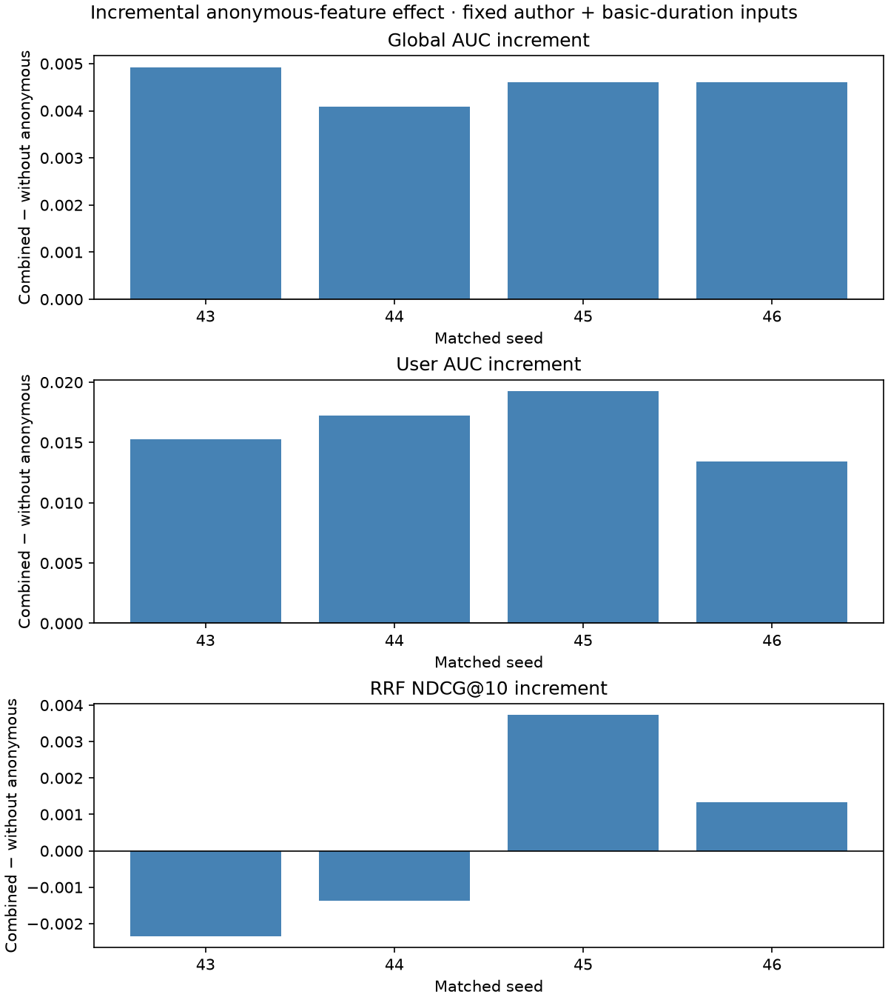
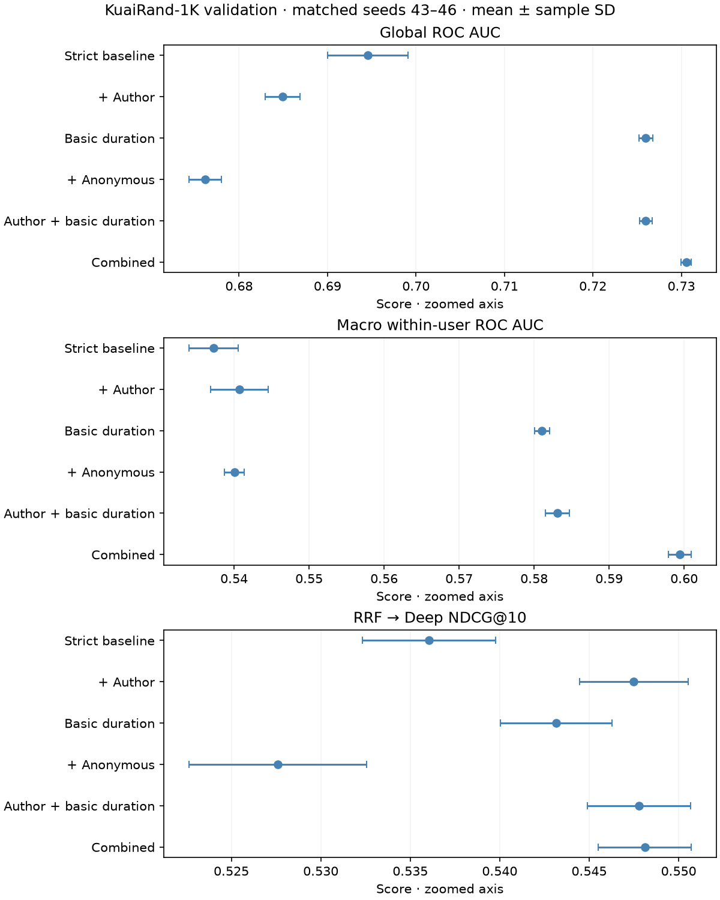
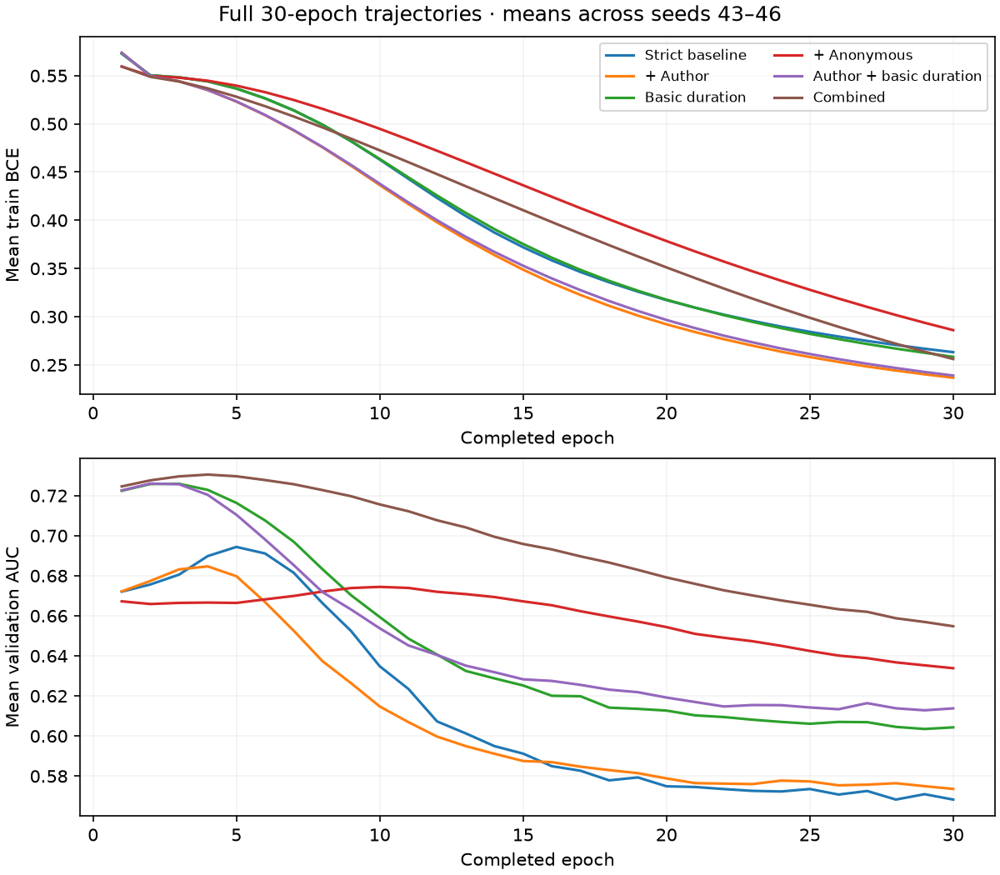

# KuaiRand-1K: merging and side-feature results

> Historical evidence and commands refer to the [pre-refactor source](https://github.com/giunglee/short-video-feed-ranker/tree/033fdc90d89a1c8b9dc5a6dbb6940290762af3a5).
> For the active implementation, use the [KuaiRand workflow](kuairand_workflow.md).

Thirty matched-seed model runs are complete: the original five feature recipes across seeds 42–46, followed by the missing author+basic-duration arm without anonymous fields. All models use a 30-epoch cap and validation-global-AUC checkpoint selection.

**Read this as validation evidence, not a final test result.** Primary summaries use seeds 43–46; seed 42 is an exploration-exposed replication. The follow-up ablation was chosen after inspecting prior validation results, so it does not create independent confirmation.

## What we learned

- Fixed RRF and round-robin each beat all three single channels on every seed 43–46 with the strict duration-band control. Mean NDCG@10 is 0.530799 for cosine, 0.536060 for RRF and 0.537075 for round-robin. This supports merging on this benchmark, not superiority of one merge policy everywhere.
- Combined side features raise mean global AUC from 0.694555 to 0.730543. Basic duration alone improves it on all four seeds; author ID improves downstream NDCG despite lower global AUC on three seeds.
- Adding anonymous fields to the strict control reduces global AUC and RRF NDCG on all four seeds. The follow-up below isolates their incremental value when author and basic duration are already present.
- **The missing control resolves the attribution:** with author and basic duration present, anonymous fields improve global AUC, macro user AUC and logloss on all four comparison seeds. RRF NDCG has two gains and two regressions; its mean gain is small relative to seed variation, so a consistent funnel improvement is not established.

## Missing ablation: incremental anonymous fields

Compare **combined** against **author + basic duration**, preserving user/item IDs, duration bands, hidden dimensions, optimizer, seeds and recall artifacts. Direction below is combined minus the recipe without anonymous fields; positive AUC/NDCG favors including them.

- Global AUC: mean paired delta **+0.004553**, sample SD 0.000349; seeds 43–46: +0.004922, +0.004080, +0.004610, +0.004602.
- Macro user AUC: mean paired delta **+0.016297**, sample SD 0.002494; seeds 43–46: +0.015282, +0.017217, +0.019241, +0.013448.
- RRF NDCG@10: mean paired delta **+0.000333**, sample SD 0.002748; seeds 43–46: -0.002348, -0.001377, +0.003731, +0.001328.
- Logloss: mean paired delta **-0.003104**, sample SD 0.001617; lower is better. This uses the AUC-selected checkpoints, not separate logloss selection.
- Seed 42 replication: global AUC +0.004967, macro user AUC +0.018835, RRF NDCG +0.001272; excluded from the primary summary above.

**Interpretation:** the anonymous group helps this combined recipe’s event-classification metrics, despite hurting when added to the strict control. AUC compares impression scores, whereas this NDCG evaluates the top 10 warm distinct items from 50 candidates using any-long-view window labels. The populations, weighting and objectives differ; higher AUC does not guarantee higher NDCG. The comparison does not isolate which anonymous semantics or capacity changes caused the effect.

Source: standard tab 1, long_view, April 29–May 1 validation; same selected checkpoints for every metric. Bars are paired seed differences, not confidence intervals. Unknown anonymous-field meanings and historical availability remain unresolved regardless of predictive performance.

## Feature comparisons

Source: same validation population and frozen per-seed recall candidates. Points show means with sample standard deviations over seeds 43–46; axes are zoomed. Global AUC covers all validation events; macro user AUC averages the 952 of 962 users with both classes. Funnel NDCG uses 949 users with warm positive items. These metrics have different populations and purposes.

- **reference**: global AUC 0.694555 ± 0.004541; macro user AUC 0.537273; RRF NDCG 0.536060.
- **add_author**: global AUC 0.684939 ± 0.001957; macro user AUC 0.540687; RRF NDCG 0.547487.
- **basic_duration**: global AUC 0.725989 ± 0.000782; macro user AUC 0.581064; RRF NDCG 0.543157.
- **anonymous_user**: global AUC 0.676168 ± 0.001849; macro user AUC 0.540034; RRF NDCG 0.527594.
- **author_duration**: global AUC 0.725990 ± 0.000688; macro user AUC 0.583115; RRF NDCG 0.547776.
- **combined**: global AUC 0.730543 ± 0.000562; macro user AUC 0.599412; RRF NDCG 0.548110.

The same new arm also supports a secondary comparison: adding author ID to basic-duration features. Paired deltas below are author+basic-duration minus basic-duration; this comparison was not an independent predeclared confirmation.

- Global AUC: mean +0.000001, sample SD 0.000498; seeds 43–46: -0.000238, +0.000398, -0.000586, +0.000431.
- Macro user AUC: mean +0.002050, sample SD 0.001757; seeds 43–46: +0.004261, +0.000461, +0.000832, +0.002648.
- RRF NDCG@10: mean +0.004619, sample SD 0.001287; seeds 43–46: +0.004626, +0.002798, +0.005600, +0.005451.

**Secondary finding:** author ID adds RRF NDCG on all four seeds when basic duration is already present, while global AUC is essentially unchanged. That is evidence for a ranking contribution under this benchmark, not an independent final-window confirmation.

## Training budget and cohorts

Each model completed 30 epochs. Lines average the same epoch across seeds 43–46; checkpoints are selected separately per run, not from the peak of the averaged curve.

- **reference**: selected epochs [6, 5, 5, 5]; warm global AUC 0.712130; cold global AUC 0.679102; 14,875,977 parameters.
- **add_author**: selected epochs [3, 4, 4, 4]; warm global AUC 0.722262; cold global AUC 0.669138; 20,490,537 parameters.
- **basic_duration**: selected epochs [3, 3, 2, 2]; warm global AUC 0.718752; cold global AUC 0.727189; 14,875,977 parameters.
- **anonymous_user**: selected epochs [11, 11, 9, 12]; warm global AUC 0.692180; cold global AUC 0.669114; 14,891,633 parameters.
- **author_duration**: selected epochs [3, 2, 2, 2]; warm global AUC 0.720754; cold global AUC 0.726038; 20,490,537 parameters.
- **combined**: selected epochs [5, 4, 4, 4]; warm global AUC 0.723300; cold global AUC 0.731601; 20,506,193 parameters.

All selected checkpoints occur by epoch 12, and the full curves show substantial later degradation despite falling training loss. This supports keeping the 30-epoch cap for these recipes; it does not justify extending them to 60 epochs or selecting final-epoch weights.

Cold event AUC measures the classifier only; cold items remain excluded from retrieval. A user-specific score can improve global AUC without distinguishing items for that user, so interpret it alongside the macro within-user metrics in the evidence file.

## Protocol and limitations

- Train: standard tab 1 before April 29; validation April 29–May 1 using raw timestamps under UTC+8 convention. All source periods were inspected during EDA. May 2–8 is reserved for final model evaluation and remains unscored.
- Deep [64,32], embedding 8, BCE, AdamW lr 0.001/decay 0, batch 4096, 30 epochs. Select maximum validation global ROC AUC, earliest exact tie. Complete curves and every reported metric come from the declared policy.
- Current strict control includes training-fitted user/item IDs, training-median duration and duration bands. The original five-epoch screen used a different reference and logloss selector; do not conflate the results.
- Author categories fit only training-item authors. Basic duration assumes a fixed media property available at scoring, including cold items. The 18 anonymous user categories fit training users only and are an explicitly accepted snapshot sensitivity.
- Null/-124/unseen values map to 0, while legitimate raw category 0 remains distinct. Current outcomes, monthly aggregates and mutable counts/status are excluded.
- Removing anonymous fields changes input width, parameter count and initialization layout. This is a controlled recipe comparison, not a causal interpretation of individual fields.
- Popularity, exact sparse cosine and BPR-MF are frozen within seed. MF uses the existing fixed-five-epoch recipe; this study does not establish its convergence.
- RRF 60 and round-robin receive top 50 from each channel and output up to 50 unique candidates; the ranker returns top 10. Source depth and candidate budget are identical across comparable policies.
- Candidate pools are warm items observed anywhere in each user’s validation window. Binary relevance is any long view in that window. This is not full-catalog/request-time next-watch evaluation. Training-catalog positive-pair coverage is 41.76%; cold retrieval remains a separate limitation.
- Paired seeds measure training variation on one reused validation set. They do not quantify new-user/time-period uncertainty. No automatic model promotion, tab 0/27K training or architecture transition is implied.

## Reproduction and verification

[Setup and commands](kuairand_baselines.md) · [Five feature recipes](https://github.com/giunglee/short-video-feed-ranker/blob/033fdc90d89a1c8b9dc5a6dbb6940290762af3a5/configs/kuairand_side_study.json) · [Missing ablation](https://github.com/giunglee/short-video-feed-ranker/blob/033fdc90d89a1c8b9dc5a6dbb6940290762af3a5/configs/kuairand_anonymous_ablation.json) · [All per-seed metrics and curves](results/kuairand_confirmation.json).

108 public-fixture tests, Ruff and diff checks pass. All 30 histories contain 30 epochs, and selected checkpoints match the earliest AUC maximum. Full validation classifier metrics were reproduced; first 8192 reloaded logits per run match exactly. All 125 original candidate exports match across feature arms within seed, and 25 missing-arm exports match their corresponding combined runs.

Raw logs, event-level outputs, user IDs, checkpoints and local reflection notes are not included in the repository evidence.

Historical context: [data/protocol EDA](kuairand_data_review.md), [field inventory](kuairand_feature_inventory.md), [initial five-epoch screen](kuairand_screen.md).
