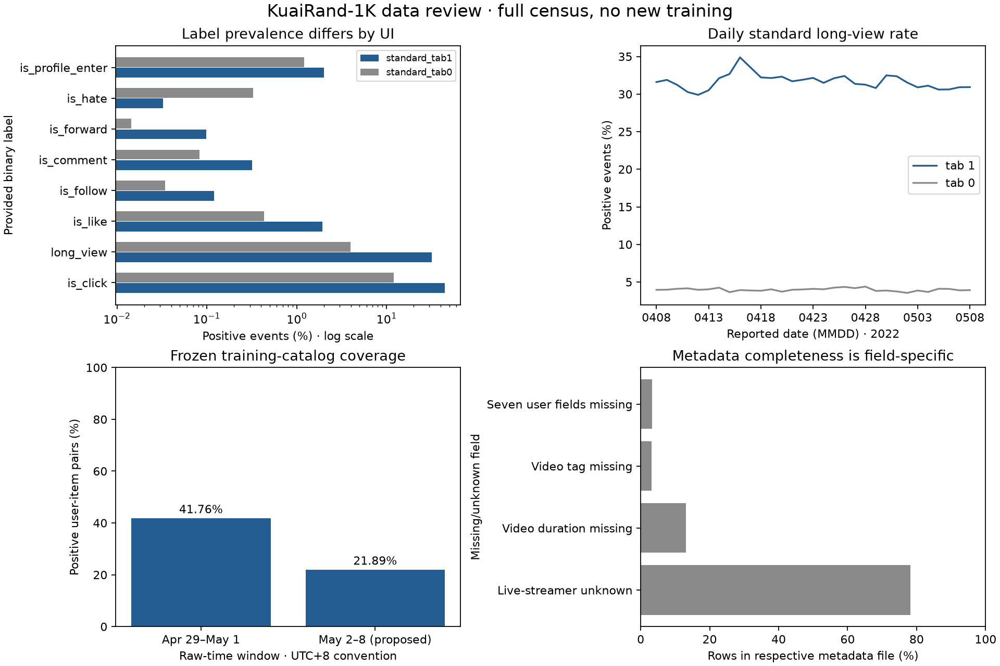

# KuaiRand data and protocol discussion — WIP

**Read this before choosing another model.** The completed Deep screen is a plumbing and exploratory result. This review revisits the dataset assumptions; it does not activate a new split, change labels, or approve a winning model. Development on 1K followed by measured expansion to 27K is the agreed direction.

Reading order: the decisions and protocol below, then the [114-field inventory](kuairand_feature_inventory.md). The [previous screen](kuairand_screen.md) remains a historical result under its original protocol. No engineered feature-cross section is included: Deep is the baseline.

## 1. Standard versus random logs

- **Standard logs answer our immediate question:** how models predict future engagement under the logged recommendation traffic. They support the initial Deep baseline, YouTube DNN retrieval, MMoE and behavior-model comparisons; random logs are not required to implement these architectures.
- **Random logs answer a different evaluation question:** how predictions behave on items exposed through randomized replacement from a restricted pool. They can help study exposure bias or provide a separate robustness benchmark. They are not synthetic negative samples.
- **Keep the primary target population standard traffic.** Do not silently mix random and standard examples: the exposure process, item pool and label prevalence differ. On 1K, deduplicated random logs contain 43,027 events and 3,621 long views, versus 11,618,821 standard events and 3,061,416 long views.
- **Do not use random logs as a universal test matrix.** The paper's random pool has 7,583 videos; only 7,388 appear in 1K random logs. It does not cover the millions of standard items. The 1K random data has just eight follows and thirteen comments, too little for a strong multi-task conclusion by itself.
- **Distinguish targets from histories.** The first baseline can remain standard-only. A future behavior model may retain strictly earlier random interactions as history, with source/context indicated, while predicting only standard targets. Dropping random rows changes the observed sequence; including them is a declared history policy, not permission to use future feedback.
- **Randomization does not erase every evaluation assumption.** The published collection mechanism randomizes item replacement within a selected pool and population. Per-event insertion propensities and complete slates are unavailable in these CSVs; do not invent full-policy IPS weights or interpret the random-minus-standard label-rate difference as causal lift.

Sources: [collection paper, §3.2](https://arxiv.org/html/2208.08696) and [release documentation](https://kuairand.com/). The recommended primary/secondary uses above are proposed experimental choices.

## 2. Tabs, interfaces and counts

- **Observed values:** all integers 0–14 occur across the 1K logs. `tab` denotes a recommendation scenario, not a train/test indicator.
- **Single-column:** `tab=1`, inferred by applying the author's “most frequent value” clarification to the measured counts.
- **Two-column:** `tab=0`, using the author's “second-most frequent value” clarification.
- **Other tabs:** additional sub-scenarios; a complete authoritative name/UI mapping is not available. Do not infer their UI from their click rates.
- **Why this affects labels:** `is_click` means valid play for the autoplay single-column interface and an actual thumbnail click for the two-column interface. “CTR” should therefore refer to tab 0 unless explicitly redefined. The provided long-view threshold is duration-dependent: completion for videos up to 18 seconds, at least 18 seconds otherwise.
- **Baseline proposal:** standard tab 1 for the next-positive-watch roadmap. Keep tab 0 as a separate CTR study if we decide to explore that product question. Combining surfaces is a later contextual modeling experiment.

Sources: [author's tab clarification](https://github.com/chongminggao/KuaiRand/issues/3) and [label definitions](https://kuairand.com/). The numerical tab-to-UI mapping is an inference from that clarification, not a published exhaustive codebook.

Counts below use **full-record deduplication**, all April 8–May 8 release dates; the random source begins April 22. Zero means no observed random events for that tab.

| tab | Standard events | Random events | UI interpretation |
|---|---|---|---|
| 0 | 2,404,886 | 0 | Two-column (inferred from author frequency mapping) |
| 1 | 7,717,596 | 42,636 | Single-column (inferred from author frequency mapping) |
| 2 | 402,293 | 73 | Other scenario; mapping unverified |
| 3 | 37,382 | 0 | Other scenario; mapping unverified |
| 4 | 895,385 | 0 | Other scenario; mapping unverified |
| 5 | 9,028 | 0 | Other scenario; mapping unverified |
| 6 | 99,087 | 0 | Other scenario; mapping unverified |
| 7 | 3,833 | 0 | Other scenario; mapping unverified |
| 8 | 17,430 | 0 | Other scenario; mapping unverified |
| 9 | 1,911 | 0 | Other scenario; mapping unverified |
| 10 | 952 | 0 | Other scenario; mapping unverified |
| 11 | 17,569 | 303 | Other scenario; mapping unverified |
| 12 | 11,007 | 0 | Other scenario; mapping unverified |
| 13 | 17 | 0 | Other scenario; mapping unverified |
| 14 | 445 | 15 | Other scenario; mapping unverified |

Raw counts before exact-row deduplication

| tab | Standard events | Random events | UI interpretation |
|---|---|---|---|
| 0 | 2,407,352 | 0 | Two-column (inferred from author frequency mapping) |
| 1 | 7,717,601 | 42,636 | Single-column (inferred from author frequency mapping) |
| 2 | 402,293 | 73 | Other scenario; mapping unverified |
| 3 | 37,418 | 0 | Other scenario; mapping unverified |
| 4 | 895,385 | 0 | Other scenario; mapping unverified |
| 5 | 16,424 | 0 | Other scenario; mapping unverified |
| 6 | 183,403 | 0 | Other scenario; mapping unverified |
| 7 | 3,833 | 0 | Other scenario; mapping unverified |
| 8 | 17,430 | 0 | Other scenario; mapping unverified |
| 9 | 1,911 | 0 | Other scenario; mapping unverified |
| 10 | 952 | 0 | Other scenario; mapping unverified |
| 11 | 17,574 | 304 | Other scenario; mapping unverified |
| 12 | 11,007 | 0 | Other scenario; mapping unverified |
| 13 | 17 | 0 | Other scenario; mapping unverified |
| 14 | 445 | 15 | Other scenario; mapping unverified |

## 3. Labels, values and cohort support

The eight supplied binary labels have no nulls or values outside {0,1} in the raw census. This is schema validity, not proof of label consistency. In tab 1, long views are common enough for the baseline; likes/profile entries are plausible later task candidates; follows/comments/forwards/hates need explicit support and variance checks.

All-month, deduplicated standard events; positive-user counts are within the tab-1 population. “Both classes” counts users for whom a within-user binary AUC can be defined.

| Label | Tab 1 positives | Tab 1 rate | Tab 0 rate | Tab 1 positive users | Tab 1 users with both classes |
|---|---|---|---|---|---|
| is_click | 3,437,373 | 44.54% | 12.01% | 991 | 991 |
| long_view | 2,444,304 | 31.67% | 3.96% | 991 | 991 |
| is_like | 148,749 | 1.93% | 0.43% | 945 | 945 |
| is_follow | 9,226 | 0.12% | 0.03% | 766 | 766 |
| is_comment | 24,614 | 0.32% | 0.08% | 678 | 678 |
| is_forward | 7,602 | 0.10% | 0.01% | 662 | 662 |
| is_hate | 2,515 | 0.03% | 0.33% | 218 | 218 |
| is_profile_enter | 155,282 | 2.01% | 1.21% | 967 | 967 |

- **Label selection is a product choice:** long view is our current engagement proxy, not universal satisfaction. A non-long-view event is an observed negative for this task, not dislike. `is_hate` is a distinct outcome.
- **MMoE candidates:** long view plus like/profile entry is a reasonable discussion starting point, not an approved task set. Check task counts per future window and per user; all-month counts can conceal sparse evaluation support. Zero is an observed label unless a known eligibility rule establishes missingness; do not invent masks to remove difficult negatives.
- **Label consistency:** even with positive duration, the documented long-view rule disagrees with 55,975/10,725,622 events (0.522%); tab-1 standard mismatch is 0.652%. Preserve provided labels in the baseline and treat recomputed labels as a separate sensitivity definition.
- **Watch time is skewed:** across all deduplicated events, median play is 3.032 s, p90 38.817 s, p99 168.898 s and maximum 1,529.347 s. These event-weighted values mix surfaces; they are not typical positive-watch duration.
- **Invalid duration is not a binary-label failure:** 936,226/11,661,848 events (8.03%) have nonpositive duration; no negative play times were found. Preserve those examples for the provided binary objective with an explicit missing feature. Do not divide by zero or manufacture a duration-derived label.
- **Ratios above one are not automatically invalid:** 1,767,389 events have play above duration and 320,018 exceed twice duration. Rewatching can contribute. KuaiRec's cap-2 regression objective should not transfer by default.

Source: full 1K census, April 8–May 8, 2022, exact-row deduplicated logs. Daily plots use reported date; split coverage uses raw timestamps under a declared UTC+8 convention. Label plot uses a logarithmic percentage axis. Metadata bars use separate user/video denominators. These are descriptive quantities, not model scores.

## 4. Feature cardinality, missingness and availability

The [field inventory](kuairand_feature_inventory.md) contains exact cardinality, row counts, frequencies, numeric quantiles and checked invalid ratios for every core column. The three concepts must stay separate: **a metadata row exists**, **its value is usable**, and **the value was available at prediction time**.

- **Sparse catalog:** training tab 1 has 977 users and 1,858,033 items. 1,205,048 items (64.86%) appear only once; median item event count is one. The many-item/few-user regime explains weak collaborative support and differs sharply from the dense KuaiRec evaluation matrix.
- **User imbalance:** training events per user range from 1 to 41,126; median 3,484, p90 11,311.8. Event-weighted objectives emphasize heavy users. Keep user-macro and activity cohorts as separate diagnostics.
- **User snapshot:** 31 fields for 1,000 users. `user_active_degree` has seven observed categories, rather than the website's shorter illustrative set. Counts: full_active 640; high_active 233; middle_active 83; 2_14_day_new 23; low_active 17; 30day_retention 2; single_low_active 2. Build mappings from training data, not a hard-coded illustrative list.
- **Unknown is not false:** `is_live_streamer` contains 782 unknown `-124` values and 218 ones, with no observed zero. Mapping unknown to false would invent a negative class. `is_lowactive_period` is constant zero across all 1,000 rows.
- **Anonymized user fields:** `onehot_feat4` and `onehot_feat12`–`17` each have 33 missing values. Observed cardinalities range from two to 394 among the anonymized columns; they are categorical codes, not ordered magnitudes.
- **Basic-video snapshot:** 4,371,868 rows, 1,407,475 authors, 2,622,610 music IDs and 32 upload types. Tags have 1,188 distinct strings but only 58 component tokens: a future multi-value encoding should distinguish the two cardinalities.
- **Video missingness:** duration is missing for 573,057 videos (13.11%); tags for 137,484 (3.14%); music type for 59,952 (1.37%). There are 9,985 AD videos and 245 unknown video types. Retaining/excluding ads changes the population and needs an explicit choice.
- **Entity coverage versus exposure coverage:** all logged users/items have core metadata rows. Yet missing video duration affects 935,903 events, and missing tags affect 293,325 events. A successful join does not guarantee a usable feature value.
- **Strict baseline features:** train-fitted user/item vocabularies and positive-duration item medians only. The fitted duration is missing for 211,310 training items (11.37%). Log-duration and missingness enter Deep; optional duration bands use fixed cutoffs. Reserve an unknown row and freeze it as already implemented.
- **Snapshot features remain excluded:** user profiles have no verified historical timestamp, and `visible_status` describes current visibility. Upload date being before an event is useful consistency evidence but does not prove every snapshot field was historically available.
- **Monthly statistics are descriptive only:** the 52 fields summarize a month and can contain future outcomes relative to our cutoff. Their complete rows and detailed distributions do not make them safe inputs. Recompute popularity/engagement aggregates strictly from allowed past events if we later test them.
- **Supplementary content:** the prior full audit found caption text on 87.92% of events and known category coverage of 99.02%, 78.30%, 34.79% and 6.13% at levels 1–4. The supplementary files cover a larger ID universe; their temporal availability remains unverified. This pass reuses those audited join results rather than rescanning 32M text records.

## 5. Train / validation / test proposal

**File names are collection partitions, not prescribed ML splits.** Join the two standard periods, preserve event time and source, then apply one global chronology. There is no dense small matrix to borrow from KuaiRec.

- **Train:** all retained standard tab-1 events with `time_ms < 1651161600000` (before April 29, 00:00 at UTC+8).
- **Validation:** `1651161600000 ≤ time_ms < 1651420800000` (April 29–May 1). Use it for width/features, epoch budget, checkpoint selection and retrieval hyperparameters.
- **Proposed final model-evaluation window:** `1651420800000 ≤ time_ms < 1652025600000` (May 2–8). Freeze the protocol before scoring models there. Its labels and coverage are EDA-exposed, including this review, so it is not a pristine untouched holdout.
- **Why preserve this split first:** training and validation match the completed screen, keeping comparisons interpretable. April 8–21 / April 22–28 / April 29–May 8 is another plausible chronology, but its last window overlaps already-used validation and would not restore an untouched test.
- **Timezone convention:** cut on raw `time_ms`; UTC+8 is our explicit interpretation for readable dates. The previous audit found 82,470 events whose timestamp-derived date differs from the reported date. Never split one user/timestamp group across partitions by mixing timestamp and date rules.
- **Primary cohort:** users with tab-1 training activity, matching the existing baseline. Report cold-user events separately; do not silently claim performance for all release users.
- **Frozen model/catalog for the first comparison:** fit vocabularies, duration medians, popularity, MF and graph edges using training only. For the table below, the catalog stays frozen through both later windows. A train+validation refit or daily refresh is a separate declared protocol and requires recomputing coverage.

Counts below are for the **training-user cohort**, deduplicated standard tab 1. Coverage is the fraction of distinct positive user-item pairs whose item appears in the training catalog; it is not Recall@K.

| Window | Events | Users | Distinct items | Long-view rate | Positive pair warm coverage |
|---|---|---|---|---|---|
| train | 4,962,447 | 977 | 1,858,033 | 31.90% | 100.00% |
| validation | 839,905 | 962 | 400,078 | 31.91% | 41.76% |
| test_candidate | 1,885,791 | 970 | 823,077 | 30.99% | 21.89% |

- **Cold users excluded from this table:** validation has 6,358 events from users without tab-1 training activity; the proposed test has 23,095. All-user window sizes are 846,263 and 1,908,886 respectively. The inventory JSON includes both populations.
- **Catalog age matters:** positive-pair warm coverage falls from 41.76% to 21.89%. A lower later score could reflect catalog turnover as well as model weakness. Keep warm-only scores, all-target recall and cold-item cohorts together.
- **Final evaluation discipline:** after agreeing on the target, cohort, budget and checkpoint rule, compare matched seeds on validation. Evaluate the locked recipe and declared baselines once on the final window; if we subsequently tune on those results, call that window development data and acknowledge the need for new confirmation evidence.

## 6. Protocol with short explanations

### Population and preprocessing

- **Task:** predict provided `long_view` on standard tab-1 exposures. This keeps the initial surface and outcome consistent.
- **Version:** record release, file hashes, preprocessing version, time cutoffs and recipe. “KuaiRand” alone is not a reproducible population.
- **Development scale:** use full-history 1K first; move to 27K after memory and runtime measurement. If sampling users, choose membership from training activity and retain their histories, rather than sampling arbitrary rows.
- **Duplicates:** remove exact complete-record duplicates as the declared baseline policy. Keep repeated user-item events and conflicting pair-time rows; without an event ID, exact duplicates can still be genuine identical observations, so this is an assumption to document.
- **Missing values:** separate nulls, unknown sentinels, invalid measurements and legitimate zeros. Define each field's handling before fitting; do not equate every zero with missingness.
- **Features:** only information available before prediction. Current outcomes, full-period averages and unverified snapshots are excluded from the strict baseline.

### Models and training

- **Recall baselines:** popularity measures a simple exposure-history preference baseline; cosine tests item-neighborhood transfer; BPR MF tests learned collaborative structure. Fit all from the same allowed past data.
- **MF negatives:** observed never-long-view items within each user's training history. These are task negatives; unexposed items have unknown outcomes. The current sampler is a baseline choice, not the sampler for every future retrieval objective.
- **Deep baseline:** embedded IDs plus strict duration features. Vary one factor at a time; no engineered crosses or extra model family is needed for the first comparison.
- **Pointwise training:** use observed positives and negatives with event-weighted BCE. Negative subsampling would change the training distribution and require calibration/weighting considerations, so do not introduce it silently.
- **Selection:** current screen selects the earliest minimum validation logloss. For the next experiment, decide whether pointwise prediction or final ranking is primary before running it; retain the other as a guardrail and do not choose a different checkpoint per reported metric.
- **Budgets and seeds:** five epochs/seed 42 were a screen, not convergence or stability evidence. Set a justified common budget, then use matched seeds for confirmation and preserve every epoch curve.

### Evaluation and serving assumptions

- **Classifier metrics:** logloss, Brier, global AUC and within-user AUC answer different questions. A model can learn user propensity while failing to order items within a user's feed. Add PR-AUC and support counts when evaluating sparse tasks.
- **Retrieval metrics:** report candidate Recall@K with both eligible warm targets and all observed positive targets in the denominator. Include catalog coverage and method support; a model cannot retrieve an unseen ID with no representation.
- **Ranking diagnostic:** the completed screen ranks warm items observed during each user's validation window. Its NDCG is conditional on those logged candidates; it does not estimate ranking over arbitrary unexposed items.
- **Candidate budget:** freeze recall candidates when comparing rankers. For channel comparisons, give channels comparable budgets and report recall, oracle ranking quality and final NDCG together.
- **History:** for a query at time t, use only earlier timestamp groups and feedback assumed available by t. Feedback completion/lag is not fully specified in the release; any lag proxy must be labeled as an assumption.
- **Tie handling:** 98.58% of standard tab-1 rows are in tied user/timestamp groups. Do not create an exposure order by sorting video IDs or using CSV row order. Next-positive-group/window targets are supportable adaptations; exact next-video order is unverified.
- **YouTube DNN transition:** define the query time, prior history, next-positive target group, horizon and candidate eligibility before changing the model. Mask other positives in the same target group from negatives; do not use future labels to clean historical samples. ANN is optional engineering after exact retrieval is understood.
- **MMoE transition:** freeze task definitions and eligibility masks, compare independent tasks/shared-bottom/MMoE on the same data, and inspect each task/cohort rather than optimizing an arbitrary sum of unlike metrics.
- **Cohorts:** always inspect warm/cold items, warm/cold users, activity and duration. Pooling tab 0 and tab 1 is a separate modeling decision, not an innocuous data expansion.
- **Inference boundary:** training-fitted transforms and artifacts must reload identically. Future catalog availability, history refresh and feedback latency are caller/product assumptions, not something offline IDs resolve.

## 7. Tomorrow's discussion

These are open decisions, not missing EDA work:

1. Keep the first product question on autoplay tab 1 / long view, with tab-0 CTR separate?
2. Accept April 29–May 1 validation and May 2–8 final model evaluation, with the EDA-exposure disclosure?
3. Keep the model/catalog frozen for the first final comparison, or study periodic refresh later? The two protocols have different coverage ceilings.
4. For YouTube DNN, choose next-positive **group** versus a fixed horizon/window, and decide whether earlier random/cross-tab interactions belong in history.
5. Choose the primary checkpoint metric and a convergence budget before confirming duration bands. Later, choose a small MMoE task set from future-window support.

Additional evidence still needed: authoritative within-tie ordering and feedback-availability semantics; timestamped feature availability; measured 27K training/optimizer memory and scoring cost; final model-evaluation results. No new model training, test-model scoring, or protocol activation occurred in this review.

## Evidence and reproducibility

This pass profiles all 114 core columns, computes raw and deduplicated tab counts, labels by source/UI, daily prevalence, activity, and proposed-window populations. Cardinalities, counts and quantiles are exact, not sampled. The [aggregate JSON](results/kuairand_deep_eda.json) records input hashes, audit source hashes, DuckDB 1.4.3, per-field rules and reused prior evidence. The feature inventory exposes all low-cardinality frequencies and the top ten for high-cardinality fields; it does not enumerate millions of IDs.

The existing census database is read-only. Full metadata profiles use entity rows; event-level joins and sequence diagnostics reuse the validated prior census. A follow-up query exactly reproduces the completed screen's 839,905 validation events, 267,995 positive pairs and 111,906 warm positive pairs. Synthetic checks distinguish missing, sentinel and invalid values. Window and denominator invariants reconcile to 7,717,596 tab-1 standard events. Visual figures are checked for readability. Detailed local scripts and source snapshots accompany the analysis artifacts.
