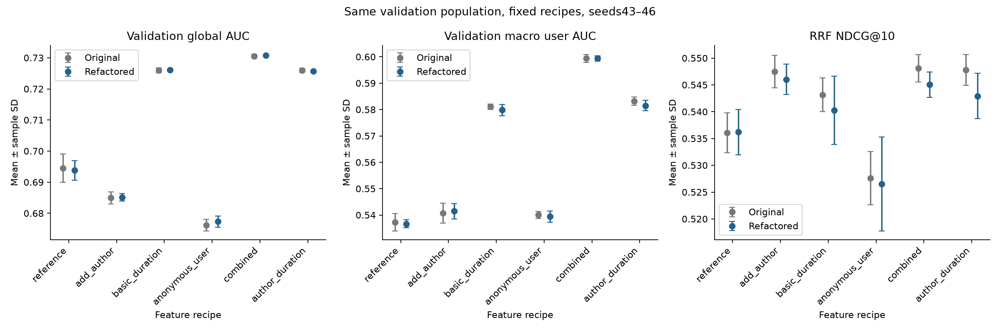
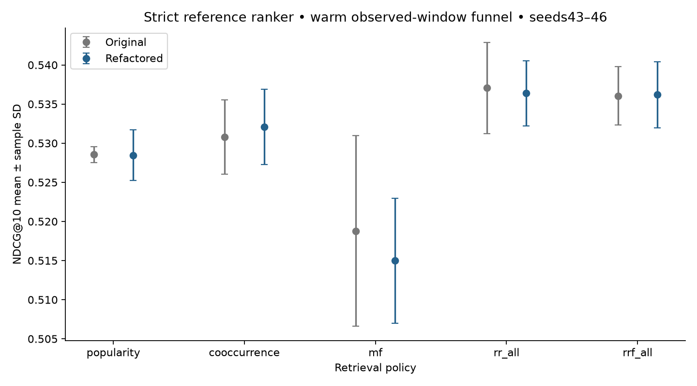
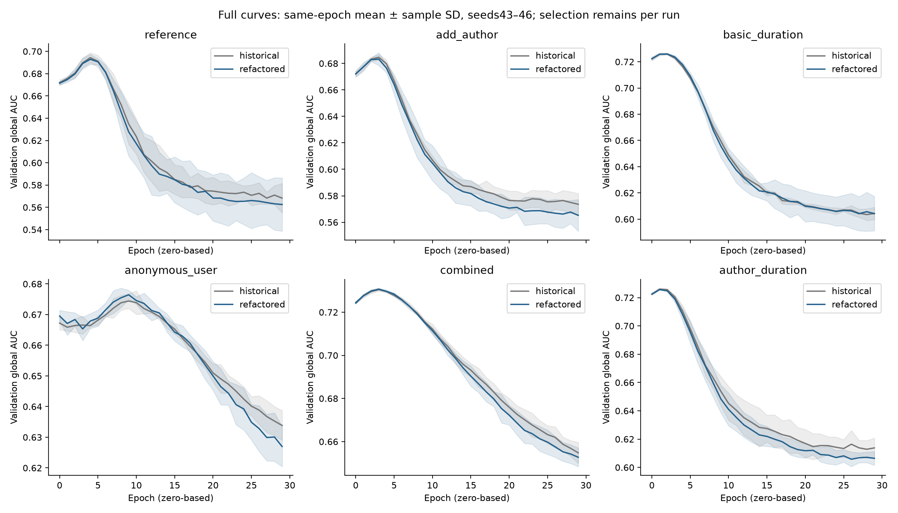

# KuaiRand refactor regression — seeds 43–46

The earlier architecture at `e520e3f` was rerun for all six feature arms: **24 fits, 30 epochs each**. This is a software/experiment regression check on reused validation, not independent final evaluation.

## Result

- Combined features minus strict reference: global AUC **+0.036972 ± 0.003117** paired sample SD; positive in **4/4 seeds**.
- Macro within-user AUC: **+0.062775 ± 0.000548**; RRF NDCG@10: **+0.008849 ± 0.005726**.
- Both RR and RRF beat every single channel on all four seeds with the strict reference ranker.
- All prepared inputs and all 120 per-arm/channel candidate exports match the historical reference exactly. Recall/support/oracle metrics are unchanged. Ranking scores differ after retraining.

## Feature results

Means over seeds 43–46; ± is sample SD over training seeds, not a confidence interval. All metrics use each run's earliest maximum-validation-global-AUC checkpoint.

| Recipe | Original global AUC | Refactored global AUC | Refactored user AUC | Original RRF NDCG@10 | Refactored RRF NDCG@10 |
|---|---:|---:|---:|---:|---:|
| reference | 0.694555 | 0.693798 ± 0.003140 | 0.536619 | 0.536060 | 0.536205 ± 0.004228 |
| add_author | 0.684939 | 0.685180 ± 0.001192 | 0.541502 | 0.547487 | 0.546035 ± 0.002860 |
| basic_duration | 0.725989 | 0.726030 ± 0.000356 | 0.579804 | 0.543157 | 0.540254 ± 0.006356 |
| anonymous_user | 0.676168 | 0.677334 ± 0.001824 | 0.539433 | 0.527594 | 0.526526 ± 0.008768 |
| combined | 0.730543 | 0.730770 ± 0.000172 | 0.599394 | 0.548110 | 0.545054 ± 0.002356 |
| author_duration | 0.725990 | 0.725708 ± 0.000290 | 0.581502 | 0.547776 | 0.542923 ± 0.004246 |



The main feature and channel-merging conclusions repeat. The narrower author
increment over basic duration is less stable: its RRF NDCG gain is positive in
3/4 seeds rather than the original 4/4, with a smaller mean and larger spread.
Anonymous fields added to the combined recipe improve AUC in 4/4 seeds, while
their incremental NDCG effect remains mixed (3 gains, 1 regression). Neither
feature group universally improves every metric.

## Incremental feature effects

Direction is first recipe minus second; these are recipe comparisons, not causal effects of individual fields.

| Contrast | Metric | Paired mean ± sample SD | Per-seed differences (43,44,45,46) |
|---|---|---:|---|
| combined − reference | long_view/roc_auc | +0.036972 ± 0.003117 | +0.039738, +0.037191, +0.038395, +0.032564 |
| combined − reference | long_view/macro_user_auc | +0.062775 ± 0.000548 | +0.063556, +0.062565, +0.062694, +0.062285 |
| combined − reference | rrf_all/ndcg | +0.008849 ± 0.005726 | +0.013861, +0.013754, +0.003776, +0.004007 |
| combined − author_duration | long_view/roc_auc | +0.005062 ± 0.000357 | +0.005206, +0.004585, +0.005033, +0.005425 |
| combined − author_duration | long_view/macro_user_auc | +0.017892 ± 0.002484 | +0.018206, +0.014339, +0.018994, +0.020029 |
| combined − author_duration | rrf_all/ndcg | +0.002132 ± 0.003328 | +0.005493, -0.001805, +0.000651, +0.004189 |
| author_duration − basic_duration | long_view/roc_auc | -0.000322 ± 0.000404 | -0.000507, +0.000279, -0.000591, -0.000470 |
| author_duration − basic_duration | long_view/macro_user_auc | +0.001698 ± 0.003597 | +0.000980, +0.006765, -0.001736, +0.000782 |
| author_duration − basic_duration | rrf_all/ndcg | +0.002669 ± 0.005989 | +0.000417, +0.010210, -0.003955, +0.004003 |

## Channel merging with the strict reference ranker

| Channel | Original NDCG@10 | Refactored NDCG@10 ± sample SD | Candidate Recall@50 | All-target Recall@50 |
|---|---:|---:|---:|---:|
| popularity | 0.528545 | 0.528471 ± 0.003259 | 0.336823 | 0.151266 |
| cooccurrence | 0.530799 | 0.532098 ± 0.004825 | 0.334303 | 0.148727 |
| mf | 0.518790 | 0.514993 ± 0.007975 | 0.355197 | 0.156891 |
| rr_all | 0.537075 | 0.536385 ± 0.004147 | 0.366894 | 0.163013 |
| rrf_all | 0.536060 | 0.536205 ± 0.004228 | 0.368893 | 0.163595 |

| Merge − single | Paired NDCG mean ± sample SD | Positive seeds | Per-seed differences |
|---|---:|---:|---|
| rr_all − popularity | +0.007913 ± 0.002301 | 4/4 | +0.006439, +0.008023, +0.011122, +0.006069 |
| rr_all − cooccurrence | +0.004287 ± 0.001695 | 4/4 | +0.002924, +0.006484, +0.004760, +0.002979 |
| rr_all − mf | +0.021392 ± 0.004004 | 4/4 | +0.024749, +0.023323, +0.015657, +0.021839 |
| rrf_all − popularity | +0.007734 ± 0.002236 | 4/4 | +0.005947, +0.007821, +0.010860, +0.006307 |
| rrf_all − cooccurrence | +0.004107 ± 0.001681 | 4/4 | +0.002433, +0.006281, +0.004497, +0.003217 |
| rrf_all − mf | +0.021213 ± 0.003980 | 4/4 | +0.024258, +0.023120, +0.015394, +0.022078 |



## Why values differ

The diagnostics separate changed training trajectories from scoring/data regressions:

1. **Inputs:** 4,962,447 train and 839,905 validation event IDs, order and labels match exactly; all 27 fitted feature columns, training vocabularies and source/snapshot hashes match.
2. **Recall:** newly fitted seed-matched MF weights and all three channels' scores are compared directly with the originals. Candidate exports and retrieval metrics match across every feature arm.
3. **Historical checkpoint replay:** mapping original weights onto the new input layout reproduces all 24 models on the full validation population. Maximum absolute global-AUC difference is 4.22e-08; maximum within-user AUC difference is 4.78e-07; maximum logit difference is 4.53e-06.
4. **Initialization:** sorted embedding construction allocates seeded random draws to different fields, and sparse-first input concatenation changes their association with first-layer weights. Across six seed43 arms, initial-logit RMSE against the old constructor is 0.0905–0.2808.
5. **Floating-point order:** even after mapping identical weights, first-layer column permutation can change rounding near ReLU zero. On the same 4096-example seed43 reference batch, one activation changes sign. Restoring historical arithmetic order yields exactly equal logits, BCE loss, every gradient and the first AdamW update. The modern objective/optimizer match in this controlled test.

These controlled tests identify initialization and arithmetic ordering as concrete sources of trajectory differences; they do not prove a causal decomposition of every final metric delta. No settings were retuned to recover historical scores.

## Selection, curves and guardrails

| Recipe | Selected epochs (43,44,45,46; zero-based) | Original selected epochs | Warm AUC | Cold AUC | Logloss | Brier |
|---|---|---|---:|---:|---:|---:|
| reference | 5, 4, 4, 4 | 5, 4, 4, 4 | 0.712609 | 0.679217 | 0.584819 | 0.197616 |
| add_author | 3, 2, 3, 3 | 2, 3, 3, 3 | 0.721916 | 0.668423 | 0.601215 | 0.202163 |
| basic_duration | 2, 2, 2, 1 | 2, 2, 1, 1 | 0.718576 | 0.727207 | 0.556497 | 0.188346 |
| anonymous_user | 10, 9, 8, 7 | 10, 10, 8, 11 | 0.697128 | 0.672320 | 0.624914 | 0.208877 |
| combined | 3, 4, 3, 3 | 4, 3, 3, 3 | 0.723857 | 0.731665 | 0.552757 | 0.186680 |
| author_duration | 1, 1, 1, 1 | 2, 1, 1, 1 | 0.719529 | 0.726165 | 0.556068 | 0.188115 |



All 720 epochs completed without nonfinite training loss/gradients. All 24 saved prediction exports independently reproduce the selected-checkpoint event/cohort metrics. Full curves and per-seed outcomes are retained in the linked evidence.

## Protocol, interpretation and limits

Source: current `e520e3f`, historical `033fdc9`; Python 3.12.9, PyTorch 2.8.0, CPU, two threads per worker. Six fixed arms × seeds 43–46; Deep [64,32], embedding8, no dropout, BCE, AdamW0.001/decay0, batch 4096, 30 epochs. MF32 runs five epochs; final MF checkpoint is fixed. RR and RRF60 take top50 per source, M50/K10.

Training is standard-tab1 before April 29; validation is April 29–May 1 (UTC+8). May 2–8 remains unscored. Author/basic-duration and anonymous snapshots retain unverified historical availability. Funnel candidates are warm items observed in each validation window; this is not a full-catalog next-watch test. Validation and earlier adaptive ablations are reused. Seed SD measures training variation, not new-period uncertainty. No numeric noninferiority margin was predeclared; direction/magnitude agreement is distinct from numerical equivalence or model promotion.

The combined-feature and multi-channel comparisons retain their direction across all four seeds. Smaller incremental feature effects remain uncertain. Higher event AUC alone is insufficient evidence of a stronger recommendation funnel.

## Evidence and reproduction

[Machine-readable evidence](results/kuairand_refactor_regression.json) contains
per-seed current/historical metrics, paired summaries, all 720 epoch AUC/loss/gradient
records, protocol, data identity, recall parity and controlled diagnostic results.
Raw events, predictions and model weights are not checked into Git.

Use the [study commands](kuairand_baselines.md#prepare-and-run) and the six-arm
configuration to rerun training. This regression uses primary seeds 43–46 only;
set both `seeds` and `primary_seeds` to those four values.
The historical comparison uses the pinned `033fdc9` checkout and its original
confirmation and author-duration ablation outputs.

The [audit command](../experiments/review_kuairand.py) consumes completed artifacts:

```sh
python -m experiments.review_kuairand \
  --current runs/refactor_regression \
  --historical runs/original_confirmation \
  --ablation runs/original_author_ablation \
  --out runs/regression_audit.json
```

The current root contains `study_config.json` and `run43` through `run46`, each
with `summary.json` and `seedN/recipe/`. Historical roots also contain
`runN/seedN/recipe/`. For a new run, execute each primary seed separately with the
same six-arm configuration to reproduce this directory layout. The audit checks
complete finite histories, the declared checkpoint policy, prediction-derived
metrics, actual candidate arrays and retrieval metric equality; it recomputes
feature summaries and seed-aligned paired differences. It fails on missing or
inconsistent results and never trains, retunes or overwrites an output.

Prepared-data comparison, MF weight/source-score parity and historical weight
replay are recorded diagnostic evidence in the JSON, not checks re-executed by
this audit command. The replay used a diagnostic weight mapping, not a supported
legacy artifact loader. No production compatibility layer was introduced.


## Reverification after the architecture merge

PR #10 now targets merged main (`3d96c3d`). The runner uses ParquetReader,
materialized EventDataset rows, job-owned optimizer settings, and the new
checkpoint/recall paths. The six recipes, seeds, objective, selection rule and
five retrieval policies are unchanged; package source is unchanged from main.

[Reverification evidence](results/kuairand_main_integration.json) confirms:

- Fresh prepared-v4 data matches all 4,962,447 training and 839,905 validation
  events and all 27 feature columns, with unchanged source/snapshot/split identities.
- All 24 saved rankers reproduce every validation logit exactly (20,157,720 total).
  All 12 source caches, 120 candidate exports, ranking traces and per-user metrics
  match. Recomputed primary-seed summaries equal the published results.
- Old/new study runners match exactly on 12 fresh public-fixture fits across all
  six recipes and two seeds: 1,248 captured arrays, non-timing histories, selected
  and final weights, optimizer/RNG state and all five pipelines.
- All 70 public-fixture tests and Ruff lint/format pass. Independent readability
  and requirements reviews found no blockers.

The combined-feature and multi-channel results above are unchanged. This is
current-code scoring and fixture-training verification, **not a new 720-epoch
full-data retraining study**. Existing validation-reuse and snapshot limitations
still apply; no model is promoted and the final window remains unscored.

For current-code scoring replay, supply freshly prepared v4 data in addition to
the saved regression and original comparison outputs:

```sh
OMP_NUM_THREADS=2 python -m experiments.review_kuairand \
  --current runs/refactor_regression \
  --historical runs/original_confirmation \
  --ablation runs/original_author_ablation \
  --prepared runs/kuairand_prepared \
  --replay-out runs/current_code_replay \
  --out runs/current_code_audit.json
```

The replay regenerates source caches from fitted popularity/cosine/MF scorers,
loads each selected ranker, recomputes event logits from materialized rows, and
executes all five pipelines. It compares predictions, source scores/support,
candidate IDs, ranking traces, per-user metrics and paired summaries exactly.
It never retrains or selects a different epoch. Synthetic tests verify that
changed saved predictions fail the audit.

For exact replay of these recorded runs, use their numerical dependencies:
Python 3.12, PyTorch 2.8.0, NumPy 2.5.3, pandas 2.3.3 and PyArrow 21.0.0.
A preliminary check with PyTorch 2.15.0 and NumPy 2.4.6 found a `5.6e-17`
difference in one cohort mean probability using unchanged metric code and saved
logits. The audit keeps its exact checks; use the recorded environment instead
of treating cross-version floating-point rounding as a source-code regression.
