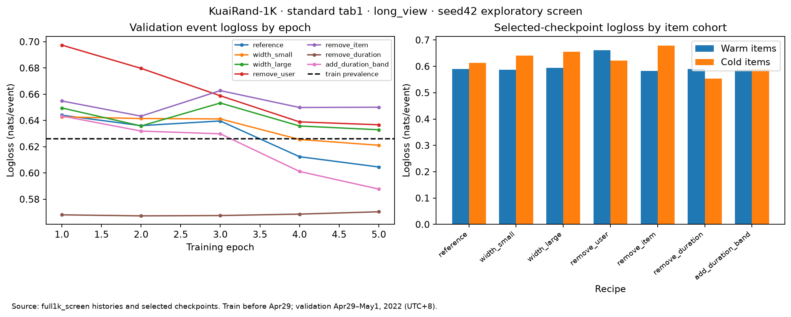

# WIP: KuaiRand recall → Deep baseline review

**Follow-up:** see [matched-seed merging, side features and anonymous-feature ablation](kuairand_confirmation.md). The five-epoch results below retain their original protocol.

**Follow-up reading:** [data analysis and protocol discussion](kuairand_data_review.md)
expands the tab/label/feature audit and proposes train/validation/final-evaluation
boundaries. Those proposals do not change this completed screen's protocol.

**Status:** implementation and the first full-1K screen are complete. Model selection
remains open. This is a single-seed exploration, not a final evaluation.

This page is the reading entry point for the draft PR. Read the findings and review
questions first; the [setup guide](kuairand_baselines.md) and
[seven recipes](../configs/kuairand_study.json) provide implementation detail.
The figures and numbers are embedded here so reviewing does not require running
the local interactive canvas.

## Problem and hypothesis

Can the existing popularity, item-cooccurrence and BPR MF recall channels plus a
Deep ranker establish a useful temporal `long_view` baseline on KuaiRand-1K?
The immediate experiment asks whether width or strictly available features change
classification quality and ordering within the same recalled candidates.

The starting hypothesis is that training-derived user/item IDs and duration provide
a reusable baseline. Each of seven recipes changes one factor. The roadmap remains
baseline validation → YouTube DNN retrieval → multi-task ranking → sequence models
→ graph models. This screen does not implement or validate those later models.

## What is implemented

- Temporal data preparation, train-only feature fitting and binary evaluation.
- Popularity, exact sparse cosine cooccurrence and BPR MF recall.
- Shared `RecommendationPipeline` execution with a Deep ranker.
- Three hidden-width choices and four feature ablations, with frozen recall
  candidates across rankers.
- Saved curves, checkpoints, inference artifacts, candidate traces and provenance.
  Artifact loaders work without raw logs or evaluation labels.

Cosine storage uses the sparse positive-interaction graph instead of an item-by-item
matrix. On this cohort, fitted arrays occupy about 69.9 MB; a dense float32 item
matrix alone would need about 13.8 TB. These figures describe model arrays, not peak
process memory. Query cost still depends on overlapping histories.

## Experiment contract

The public [KuaiRand dataset](https://kuairand.com/) supplies the `long_view` label.
This screen uses standard `tab=1` traffic from the 1K release:

- **Training:** before April 29, 2022, 00:00 UTC+8; 4,962,447 events,
  977 eligible users and 1,858,033 items.
- **Validation:** April 29 through May 1, ending May 2, 00:00 UTC+8;
  839,905 events from 962 users. Positive event rate: 31.91%.
- **Preprocessing:** `kuairand-temporal-binary-v1`. Remove exact complete-record
  duplicates; retain repeated events/pairs and whole timestamp groups.
- **Features:** training-fitted IDs and positive-duration item medians, explicit
  missing values and frozen-zero unknown-ID embeddings. No public profile/item
  snapshots or event-outcome features. Duration bands use 10/30/60-second cutoffs.
- **Budget:** seed 42, seven recipes, five epochs each. Deep uses 8-dimensional
  embeddings, AdamW at 0.001, batch size 4,096 and no dropout/weight decay.
  Select minimum validation event logloss, earliest tie.
- **Recall:** popularity counts distinct positive users; cosine aggregates positive
  history similarities; BPR uses 32-dimensional embeddings and observed
  never-positive items as task negatives. Use its fixed fifth-epoch checkpoint.
- **Ranking diagnostic:** one query per user/validation window; any positive event
  makes an item relevant, and repeats remain eligible. Recall up to 50 and rank 10.
  Candidate pools contain warm, observed validation items. NDCG uses binary linear
  gains and the full warm-pool ideal ranking; metrics average over eligible users.
  Zero-positive queries are excluded from the corresponding metric denominator.

Event logloss selects checkpoints; AUC, Brier, warm/cold cohorts, candidate recall,
NDCG, oracle NDCG and support shortfalls are guardrails. All release dates were
previously examined during EDA. There is no untouched test result here.

## Findings to review

**1. Duration bands merit a confirmation experiment.** Relative to the reference
Deep `[64,32]`, adding a duration band reduced validation logloss from **0.6046 to
0.5877** and increased MF → Deep NDCG@10 from **0.4955 to 0.5189**. Both selected
their fifth, final epoch, so the training budget is not yet justified by convergence.

**2. The best global classifier was a worse within-user ranker.** Removing duration
produced the lowest logloss, **0.5673**, and highest global AUC, **0.7062**, but MF → Deep
NDCG fell to **0.4445**. Its macro within-user AUC was approximately **0.500**.
The corresponding reference values were global AUC **0.6838** and within-user AUC
**0.5305**. The evidence supports separating user propensity/calibration from item
ordering; selecting solely by global classification metrics would miss this failure.

**3. Catalog coverage is a major limitation.** Only **41.76%** of positive validation
user-item pairs involve training-catalog items. Cold items account for **62.60%**
of validation events. Every recipe assigns identical scores to cold items within
each user because their item and duration inputs collapse to the same missing
representation. Their within-user cold AUC is exactly 0.5. Global cold AUC therefore
does not demonstrate cold-item discrimination.

**4. Better recall did not automatically mean better final ranking.** Conditional
Recall@50 was **0.3368** for popularity, **0.3343** for cosine and **0.3564** for MF.
With the reference Deep ranker, final NDCG@10 was **0.5078**, **0.5072** and **0.4955**,
respectively. With duration bands it was **0.5253**, **0.5293** and **0.5189**.
Channel merging was not tuned in this screen.

Open the image for a larger view. Full numeric results and per-epoch curves are in
the [aggregate evidence](results/kuairand_screen_seed42.json).

## Limits and proposed next decisions

The screen verifies a reusable baseline and identifies failure modes. It does not
establish a winning recipe. These are proposed next steps for review:

1. Review the curves and set a comparable training budget before confirming the
   reference versus duration bands across matched seeds. Decide how checkpoint
   selection should reflect the downstream ranking question.
2. Keep within-user and warm/cold diagnostics alongside global classification
   metrics. Plan cold-item features only after establishing their availability.
3. Measure ingestion, dense MF/optimizer memory and scoring cost before moving to
   27K. Current preprocessing and training materialize selected events in memory.
4. For YouTube DNN, define time-local query histories, positive targets and catalog
   eligibility. Observed-window candidates cannot establish full-catalog next-watch
   retrieval performance.
5. For MMoE, define task labels, missing-label masks and competing objectives before
   changing the architecture.

These results are conditional on logged exposures. They are not online, causal,
randomized-exposure, full-catalog or next-event estimates. One seed cannot establish
training stability, and the validation cohort does not estimate uncertainty over
future traffic.

## Reproduction and verification

Follow the [prepare/run commands](kuairand_baselines.md#prepare-and-screen).
The committed recipe version is `kuairand-strict-screen-v1`; this run used seed 42
and five epochs for both Deep and MF. The evidence file includes the protocol,
preprocessing-manifest hash, aggregate results, diagnostic summaries and epoch
curves. Raw logs, event-level predictions and model checkpoints remain local.

Validation completed with 102 tests, Ruff and diff checks. Focused checks cover
temporal boundaries, train-only feature fitting, sparse/dense cosine parity,
all seven recipes, standalone artifact reload and corrupted-artifact rejection.
Post-run checks found identical recall candidates across all seven rankers,
checkpoint selection matching the earliest logloss minimum, and exact reload
predictions for the first 8,192 validation events of each recipe.

No recipe has been promoted, no multi-seed confirmation has run and no 27K model
has been trained.
