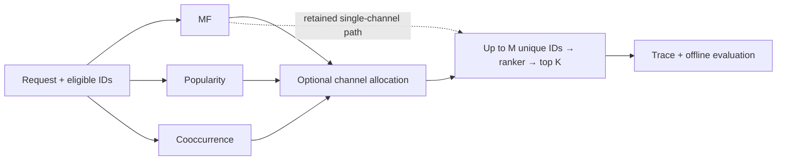
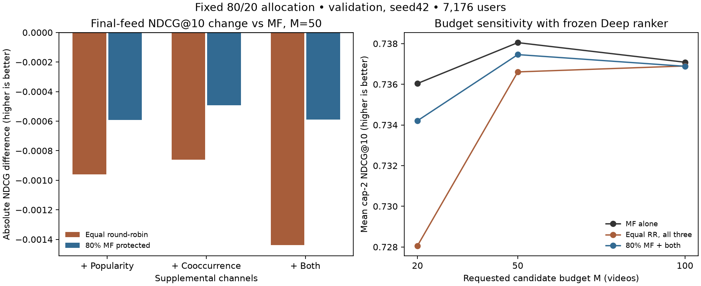

# Combining retrieval channels without changing the ranking pipeline

> Historical evidence and commands refer to the [pre-refactor source](https://github.com/giunglee/short-video-feed-ranker/tree/033fdc90d89a1c8b9dc5a6dbb6940290762af3a5).
> For the active implementation, use the [KuaiRand workflow](kuairand_workflow.md).

**MF remains the single-retriever reference.** Multi-channel retrieval is now an
optional component: it combines ranked lists into one deduplicated budget before
the existing ranker runs. The experiment explains why this capability is useful
for future comparisons without promoting the current merges on quality.



- **Composition:** [`ChannelRetriever.retrieve`](https://github.com/giunglee/short-video-feed-ranker/blob/033fdc90d89a1c8b9dc5a6dbb6940290762af3a5/src/feed_ranker/inference/channels.py)
- **Allocation:** [`anchored_candidates`](https://github.com/giunglee/short-video-feed-ranker/blob/033fdc90d89a1c8b9dc5a6dbb6940290762af3a5/src/feed_ranker/recommendation/merging.py)
- **Execution:** [`RecommendationPipeline.recommend`](https://github.com/giunglee/short-video-feed-ranker/blob/033fdc90d89a1c8b9dc5a6dbb6940290762af3a5/src/feed_ranker/recommendation/pipeline.py)
- **Diagnosis:** [`ChannelDiagnostics.compare`](https://github.com/giunglee/short-video-feed-ranker/blob/033fdc90d89a1c8b9dc5a6dbb6940290762af3a5/src/feed_ranker/evaluation/channels.py)

## Policies and boundaries

| Policy | Admission rule | Trade-off |
|---|---|---|
| Round-robin | One unique item per active channel per cycle | Shares opportunity, even when channel quality differs |
| Reciprocal rank fusion | Sum `1 / (60 + source_rank)` across channels | Rewards agreement; correlated channels can amplify the same preference |
| MF-anchored | Protect `floor(0.8 × M)` MF items, fill from other channels | Limits displacement while reserving supplemental capacity |

Duplicates consume no slots; exhausted channels yield capacity. Anchored allocation
fills unused supplemental slots with the MF tail, and unused MF slots with supplements.
At M50 this protects 40 MF items; the remaining ten may include MF ranks 41–50.
It does **not** require ten replacements. Small pools and unsupported items still
produce explicit shortfalls. No labels enter allocation.

All policies consume full supported eligible rankings in this bounded-catalog
experiment. Equal final M does not establish equal retrieval cost or serving latency.
Channel order and ties are deterministic; child artifact identities and policy
parameters determine the composite artifact identity. Traces record merged order,
retrieval score, ranking score and final rank; merged order is not a child-source rank.

## Findings: protect MF, but do not assume supplements improve it

Frozen original Deep/profile ranker, seed42, M50/K10; equal-user means:

| Retrieval | Final cap-2 NDCG@10 ↑ | Binary Recall@50 ↑ | Candidate oracle ↑ |
|---|---:|---:|---:|
| **MF alone** | **.738048** | **.623405** | **.986564** |
| All three, equal round-robin | .736608 | .607276 | .984644 |
| All three, equal RRF | .725592 | .601226 | .976731 |
| 40 MF + popularity | .737455 | .616666 | .986397 |
| 40 MF + cooccurrence | .737555 | .618790 | .986131 |
| 40 MF + both supplements | .737459 | .617743 | .986296 |



- **Why equal merging loses:** popularity/cooccurrence top50 Jaccard is .818.
  All-three RRF replaces 10.03 candidates/user, adding 4.55 positive pairs while
  losing 5.78. Added/displaced mean capped gain is .951/1.110. Agreement between
  these similar channels is not independent evidence of better candidates.
- **Why protecting MF helps:** the 40+10 three-channel variant recovers 59% of
  round-robin's NDCG gap. MF final-top10 removals fall from .435 to .148/user.
  But additions still have lower mean observed gain than displaced items (.932/.986).
- **Why the loss does not disappear:** only .150 newly added items/user enter
  the final feed. Even reranking the larger union with all MF candidates retained
  gives .737386, below MF alone. Candidate utility and ranker ordering both matter;
  this diagnostic is not a causal estimate or an equal-budget competitor.
- **Where it loses:** three-channel anchored ΔNDCG is zero for pools ≤50,
  +.000303 for pools 51–150 and −.001294 for pools >150. These are descriptive
  cohorts, not selected routing rules. Anchored merges also remain below MF at M20/100.

**Decision:** keep MF for the retained pipeline; expose merging for future experiments.
Before a wider allocation search, seek complementary candidate utility and inspect
the ranker's errors on additions. Cooccurrence has the closest anchored point estimate,
but this pilot does not establish a preferred supplement.

## Protocol and limits

- Same first-event labels, training-supported observed validation pools and frozen
  models. Ranker: capped MAE, Deep `[64, 32]`, epoch113 selected by validation
  user-XAUC. This is the original reference, **not the duration-band-removal variant**.
- Final utility is linear `min(2, watch_ratio)`; full eligible-pool IDCG, K10,
  7,176 users. Binary sufficient-viewing Recall excludes one zero-positive user.
- Historical RR/RRF policies first rerun; then one declared 80/20 allocation with
  three supplements. No retraining, test access, quota sweep or checkpoint reselection.
- Three-channel anchored ΔNDCG versus MF: −.000589, paired-user bootstrap 95%
  interval [−.001109, −.000113]; versus equal RR: +.000851 [.000368, .001377].
  These 1,000 resamples measure conditional user uncertainty, not training-seed
  variation. Reused validation and multiple comparisons limit confirmation claims.
- Observed pools cannot establish full-catalog or online lift; snapshot timing and
  short-video concentration remain limitations. No new multi-seed merging claim.

[All methods/budgets](results/channel_merging_seed42.csv) ·
[Paired diagnostics](results/channel_allocation_diagnosis.csv).

## Use the existing inference and evaluation boundaries

```python
from feed_ranker.inference.channels import ChannelRetriever
from feed_ranker.recommendation.pipeline import RecommendationPipeline

# mf, popularity and ranker are already loaded inference adapters.
retriever = ChannelRetriever([mf, popularity], policy="anchored", anchor_fraction=0.8)
pipeline = RecommendationPipeline(retriever, ranker, budget=50, k=10)
response = pipeline.recommend(request, eligible_scope)
# Retained default: RecommendationPipeline(mf, ranker, budget=50, k=10).
```

The [existing evaluator](https://github.com/giunglee/short-video-feed-ranker/blob/033fdc90d89a1c8b9dc5a6dbb6940290762af3a5/src/feed_ranker/experiments/evaluate_funnel.py) accepts
multiple artifacts and an optional merge policy. Without it, methods run separately:

```sh
python -m feed_ranker.experiments.evaluate_funnel \
  --data PATH/TO/recall_data --ranking-data PATH/TO/ranking_data \
  --ranker PATH/TO/ranker_artifact \
  --retrievers PATH/TO/mf_artifact PATH/TO/popularity_artifact PATH/TO/cooccurrence_artifact \
  --merge-policy anchored --anchor mf --anchor-fraction 0.8 \
  --output artifacts/channels_seed42 --threads 1
```

Choose `round_robin` or `rrf` for the other policies; pass two artifacts for a
two-channel comparison. `--execution model` uses actual model calls, while replay
caches **each child** before composing them. Each budget executes independently:
anchored candidate sets are not prefixes of one full-pool merged ranking.
The runner saves singleton controls, merged metrics, actual candidate Recall,
duration diagnostics, traces, source snapshot and input hashes. Labels stay in
evaluation. Public synthetic checks cover allocation, exhaustion, empty scopes,
artifact identity and model/replay equivalence; local frozen-model checks preserve
candidate and top10 IDs across 48 anchored requests.

On the feature-study base, **97 tests** and Ruff pass. The public command reproduces
all 12 singleton/anchored budget metric comparisons within 1e-12 and all four M50
candidate exports exactly. No historical experiment-directory layout is required
by the public runner; only prepared data and exported inference artifacts.
