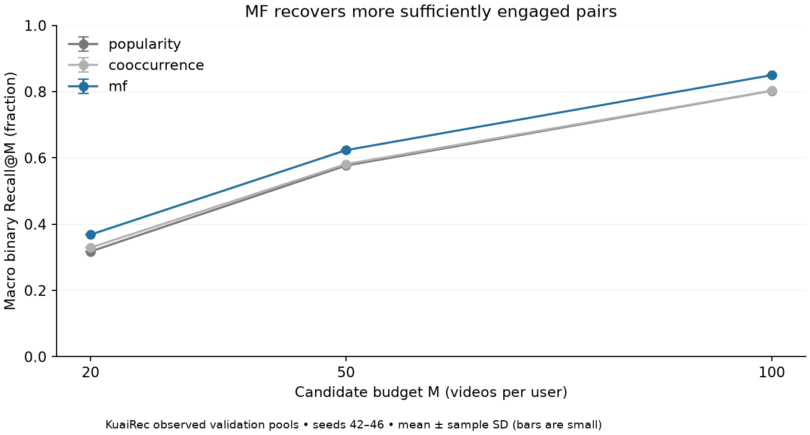

# Recall: decisions and review guide

**Task:** find useful unseen user–video pairs for existing users in KuaiRec.
This benchmark measures preference generalization within observed held-out pools,
not next-watch prediction or catalog-wide online performance.

## Frozen contract

| Decision | Rule | Why / boundary |
|---|---|---|
| Split | Big matrix; inherited 90/10 pair split, seed2026; exact-signature deduplication | All events of a pair stay together; no new small-matrix test use |
| Pair label | Earliest observed event; stable source row resolves ties or missing time | First exposure fits unseen-pair retrieval; repeated outcomes are not extra training pairs |
| Positive | `r >= min(1, sqrt(10/d))`, duration `d` in seconds | Sufficient viewing proxy; threshold parameters have **not** been sensitivity-tested |
| Clear negative | `r < min(0.3, 0.5 * positive_threshold)` | Disjoint positive/negative labels with a neutral band |
| History | Unique training-positive videos; full history | No validation behavior; all training outcomes count as seen |
| Catalog/pool | Training catalog intersected with each user's observed validation pairs; exclude seen pairs | Unobserved pairs have unknown outcomes, not negative labels |
| Evaluation | Equal-user Recall@20/50/100; headline M50 | Full eligible relevant-item denominator; zero-positive users excluded and counted |
| Shortfall/ties | No backfill; seeded ID ordering | Report pool shortage separately from method shortage; never shrink denominators to returned items |

Missing/tied timestamps and inconsistent repeated behavior are heuristic limitations.
Candidate metadata at the rank boundary uses training-only median video duration.

## Methods and training

- **Popularity:** number of positive training users per video.
- **Cooccurrence:** cosine-normalized positive-user incidence, diagonal removed;
  sum neighbor evidence over the user's full positive history. Zero evidence is unsupported.
- **MF:** 32-dimensional user/item dot products; BPR; one uniformly sampled
  observed clear negative per positive pair per epoch, with replacement.
  Users need both training classes; items need training updates.
- **Budget:** AdamW lr=.001, weight decay=.0001, batch4096, 15 epochs;
  select maximum validation binary Recall50, earliest exact tie; seeds42–46.
  These are fixed defaults, not a claimed optimum. Active users contribute more pairs.
- **Exploration:** negatives+neutrals raised Recall50 in seed42 but did not improve
  final capped-watch utility. Retain clear negatives; no seed-robust rejection claim.

## Evidence and limitations



[Per-seed metrics](results/recall_validation.csv) support the figure. The experiment
note and headline comparisons belong in the PR description, avoiding parallel reports.

- 7,176 users; 1,030,046 eligible validation pairs. Excluded:50 pairs including45
  positives outside the training catalog. Binary quality metrics cover7,175 users.
- No true cold-user coverage in this dataset. Dense observed pools, non-temporal
  holdout and earlier project test exposure limit transfer claims.
- Duration concentration remains; a duration-adjusted threshold does not establish
  duration fairness. Watch behavior is a utility proxy, not satisfaction.
- Seed42 informed exploration;43–46 have earlier ranking history. Multi-seed results
  test training stability on a reused validation split, not independent holdout validity.

## What remains untested

**Next focused question:** label sensitivity. First audit train-only positive/negative
rates, pair-label flips and user support for nearby curve anchors (for example8/10/12s).
If material, compare one declared alternative with capped final utility, pools and
ranker held fixed. A label change also changes histories and baseline counts; rebuild
all affected methods for a fair recipe comparison. Do not select a curve by whichever
binary Recall score is highest under its own labels.

Other fixed choices: negative cutoff, pair weighting, embedding dimension, optimizer
settings and recall checkpoint selector. No broad sweep is required to review this
bounded baseline; list these as assumptions, not validated best practices.

## Run / review

After preparing ranking data with `signature-dedup-v2`:

```sh
python -m feed_ranker.data.recall --raw-big PATH/TO/big_matrix.csv --ranking-data PATH/TO/ranking_data --output artifacts/recall/data
python -m feed_ranker.experiments.recall_kuairec --data artifacts/recall/data --method popularity --output artifacts/recall/popularity
python -m feed_ranker.experiments.recall_kuairec --data artifacts/recall/data --method cooccurrence --output artifacts/recall/cooccurrence
python -m feed_ranker.experiments.recall_kuairec --data artifacts/recall/data --method mf --epochs 15 --seed 42 --threads 1 --output artifacts/recall/mf42
```

Repeat MF for seeds43–46. Use fresh output paths; saved configs, hashes, curves and
checkpoints capture provenance. Public synthetic tests need no downloaded dataset.
Read: data/recall → models/recall → training/recall_evaluation → experiments/recall_kuairec.

References: [KuaiRec](https://kuairec.com/),
[BPR](https://arxiv.org/abs/1205.2618). This implementation uses observed clear
negatives; original implicit-feedback BPR samples from unobserved items.
