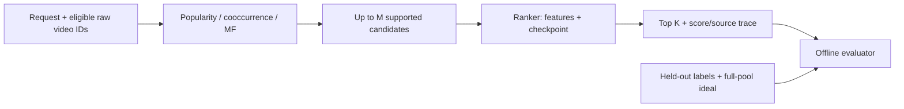
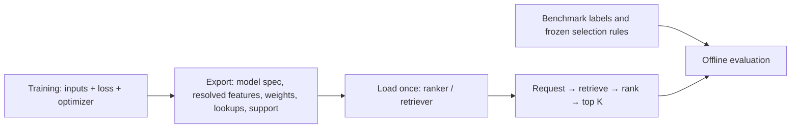
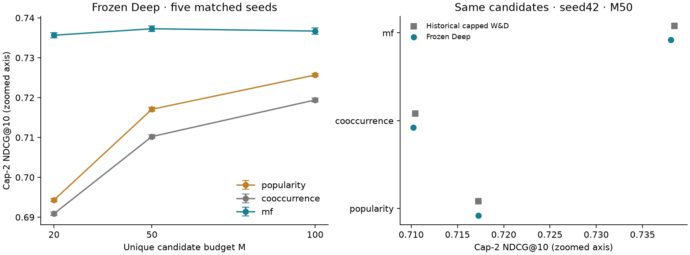

# Two-stage recommendation: retrieve candidates, then rank the feed

> Historical evidence and commands refer to the [pre-refactor source](https://github.com/giunglee/short-video-feed-ranker/tree/033fdc90d89a1c8b9dc5a6dbb6940290762af3a5).
> For the active implementation, use the [KuaiRand workflow](kuairand_workflow.md).

**Retained pipeline:** popularity, cosine item cooccurrence or BPR MF → frozen
capped Deep `[64, 32]` → top-10 feed. MF produces the strongest final feed among
these retrieval methods across five matched seeds. **The Deep upgrade itself is
not a demonstrated funnel improvement over historical capped Wide & Deep.**

**Observed held-out pool → Retrieve M unique videos → Fixed Deep ranker → Top 10.**

## Reusable recommendation execution

The single-retriever pipeline separates execution from its offline benchmark:



- **Execution:** `RecommendationPipeline.recommend(request, scope)` calls one
  retriever, scores only its candidates, and returns top K plus a compact trace.
  Requests and stage results contain raw IDs, never label arrays or pool offsets.
- **Replaceable components:** retrievers implement `retrieve(request, scope, limit)`;
  rankers implement `score(request, items)`. Construct the pipeline with different
  instances; no registry or experiment-specific orchestration is required.
- **Features and identity:** the Deep adapter loads its checkpoint and train-derived
  lookups once from a self-contained artifact. Dense embedding IDs stay inside adapters. Query IDs are distinct
  from user IDs, allowing another dataset adapter to represent repeated requests.
- **Eligibility:** callers supply the permitted catalog subset and seen-item policy.
  The KuaiRec adapter supplies observed held-out IDs, without their labels. This is
  an offline evaluation restriction, not a restriction in the pipeline interface.
- **Failure semantics:** unsupported retrieval items are omitted and counted;
  malformed scores, duplicate IDs, ineligible candidates, and ranker misalignment
  fail explicitly. There is no implicit popularity fill or random fallback.
- **Evaluation:** the evaluator consumes the already ordered final list. The full
  eligible pool still defines IDCG. Full-pool scoring is a separate benchmark
  diagnostic; a recommendation request needs scores only for its own candidates.

```python
from pathlib import Path
from feed_ranker.inference.artifacts import load_ranker, load_retriever
from feed_ranker.recommendation.contracts import CandidateScope, Request
from feed_ranker.recommendation.pipeline import RecommendationPipeline

# These directories contain manifest.json + state.pt, with no dataset dependency.
retriever = load_retriever(Path("artifacts/inference/seed42/mf"))
ranker = load_ranker(Path("artifacts/inference/seed42/ranker")).ranker
pipeline = RecommendationPipeline(retriever, ranker, budget=50, k=10)
response = pipeline.recommend(
    Request(query_id="request-001", user_id=raw_user_id),
    CandidateScope(eligible_video_ids),
)
recommended_ids = response.items
# response.retrieved / response.ranked retain aligned scores and source order;
# response.final_positions identifies the selected positions in those arrays.
```

Implementation responsibilities:

- **Features:** [`features/config.py`](https://github.com/giunglee/short-video-feed-ranker/blob/033fdc90d89a1c8b9dc5a6dbb6940290762af3a5/src/feed_ranker/features/config.py) declares inputs; [`features/kuairec.py`](https://github.com/giunglee/short-video-feed-ranker/blob/033fdc90d89a1c8b9dc5a6dbb6940290762af3a5/src/feed_ranker/features/kuairec.py) fits training lookups and builds candidate features from saved state.
- **Models:** [`models/`](https://github.com/giunglee/short-video-feed-ranker/blob/033fdc90d89a1c8b9dc5a6dbb6940290762af3a5/src/feed_ranker/models) contains shared mathematical implementations; `ranking_factory.py` constructs them from an explicit `ModelSpec`.
- **Training:** [`training/`](https://github.com/giunglee/short-video-feed-ranker/blob/033fdc90d89a1c8b9dc5a6dbb6940290762af3a5/src/feed_ranker/training) owns optimization, sampling, baseline fitting and artifact export. It invokes evaluation without owning its implementation.
- **Inference:** [`inference/`](https://github.com/giunglee/short-video-feed-ranker/blob/033fdc90d89a1c8b9dc5a6dbb6940290762af3a5/src/feed_ranker/inference) loads artifacts and adapts fitted models to `retrieve` / `score`. Loading requires no experiment dataset or recipe.
- **Recommendation:** [`recommendation/`](https://github.com/giunglee/short-video-feed-ranker/blob/033fdc90d89a1c8b9dc5a6dbb6940290762af3a5/src/feed_ranker/recommendation) owns request/result contracts, pipeline ordering and label-free traces. The pipeline is unchanged when a fitted model is replaced.
- **Evaluation:** [`evaluation/kuairec.py`](https://github.com/giunglee/short-video-feed-ranker/blob/033fdc90d89a1c8b9dc5a6dbb6940290762af3a5/src/feed_ranker/evaluation/kuairec.py) builds observed scopes and verifies splits; [`evaluation/funnel.py`](https://github.com/giunglee/short-video-feed-ranker/blob/033fdc90d89a1c8b9dc5a6dbb6940290762af3a5/src/feed_ranker/evaluation/funnel.py) aligns response IDs to labels and returns `FunnelReport(metrics, per_user, duration)`.
- **Experiments:** [`evaluate_funnel.py`](https://github.com/giunglee/short-video-feed-ranker/blob/033fdc90d89a1c8b9dc5a6dbb6940290762af3a5/src/feed_ranker/experiments/evaluate_funnel.py) assembles the benchmark from ready artifacts. [`convert_inference.py`](https://github.com/giunglee/short-video-feed-ranker/blob/033fdc90d89a1c8b9dc5a6dbb6940290762af3a5/src/feed_ranker/experiments/convert_inference.py) separately migrates old runs and checks the frozen Deep reference.

The experiment no longer maps candidate IDs to label-array positions or constructs trace rows:

```python
results = [pipeline.recommend(request, scope) for request, scope in benchmark]
report = FunnelEvaluator(benchmark.pool).evaluate(results)
RecommendationTrace.from_results(results).write(output_prefix)
```

### Training → artifact → inference



**The artifact defines how to predict; the benchmark defines which artifact to compare.**
`ModelSpec` contains architecture/widths/dropout; existing `FeatureConfig` declares
ordered inputs, vocabulary sizes and numeric transforms. Training owns optimizer,
seeds, sampling and checkpoint selection. The model implementation is shared.
New architecture-study checkpoints save both resolved specifications. Historical
architecture recipes are interpreted only by the offline converter.

Each inference artifact contains a versioned `manifest.json` and checksummed
`state.pt`: model weights or fitted retrieval statistics, exact ID mappings,
required encoded user attributes, training-median item durations and support masks.
Loaders need neither training nor validation files and preserve the caller's Torch
RNG. A feature removal changes the saved configuration, not the inference loader.
Unsupported schemas, inconsistent vocabulary sizes, corrupt state and incompatible
weights fail explicitly. Unknown categorical IDs retain the existing OOV behavior.

`RecallTrainingState` supplies the sampler with positive/negative/neutral histories;
it has no evaluation pools or file paths. `ObservedBenchmark` owns query scopes and labels; `FunnelEvaluator` owns response
alignment and metrics. The frozen Deep/cap-2/user-XAUC restrictions belong to
`FrozenDeepReference`, not the generic loader. Export preserves historical MF row
mappings, including unsupported users; rebuilding a vocabulary could change which
embedding belongs to a user.

The feature builder supports scalar KuaiRec inputs, declared wide crosses and
sum-pooled item categories through fitted item lookups. Behavior sequences require
a separate contract. These capabilities do not change the frozen feature recipe.
Training event duration and candidate training-median duration remain distinct,
explicit source policies.

The benchmark loads existing artifacts; it never exports or reconstructs a model.
`--execution replay` caches their scores for repeated budget comparisons;
`--execution model` runs the actual retriever and selected-candidate ranker for each
request. Both use the same pipeline and evaluator. Full-pool scoring is an explicit
offline reference. Candidate traces retain source rank, both scores and final rank;
a separate request trace retains artifact identities and shortfalls even when no
candidates were returned. Labels and duration cohorts stay in evaluation reports.

MF remains the retained single-retriever reference. Optional
[channel composition](recall_channels.md) uses the same execution interface and
evaluator; current exploratory merges do not improve on MF. Exact cooccurrence retains a quadratic item
similarity matrix suited to this bounded catalog; the refactor does not establish
large-catalog memory/latency suitability. Observed-pool results are not full-catalog
recommendation estimates.

## What is fixed, and why?

| Boundary | Contract | Rationale |
|---|---|---|
| Candidates | Same saved retrieval scores and candidate identities; M=50 primary, M=20/100 sensitivity | Isolate the downstream ranker change; no recall retraining |
| Recall | First-event duration-adjusted binary labels; clear-negative BPR; validation Recall@50 checkpoint | Retrieve sufficiently viewed pairs without treating unknown exposure as a negative |
| Ranking | Event-weighted MAE on `min(2, watch_ratio)`; frozen architecture-study checkpoints, seeds 42–46 | Preserve the approved utility and independently selected recipe |
| Rank checkpoint | Maximum capped validation user-XAUC, earliest tie, within 120 epochs | No reselection on funnel NDCG or choosing the best seed |
| Candidate features | Saved vocabularies; training-only median video duration and derived band; profiles from prepared training records | No held-out watch outcome or event duration enters inference |
| Final evaluation | First-event **linear cap-2 gain**, full-pool IDCG, equal-user mean, K=10 | Count both retrieval misses and ranker ordering errors |

Deep uses ID, age-range, follow-count-range and duration-band embeddings (width 8),
log-duration input, hidden widths `[64, 32]`, and no dropout. See the
[architecture study](ranking_architecture.md). Profile snapshot timing remains
**unverified**: reconstructing the training inputs does not prove historical
recommendation-time availability.

For each user, `DCG@10 = sum(min(2, watch_ratio_i) / log2(i+1))`, for positions 1–10.
IDCG orders all eligible pool items by that gain, including unretrieved items.
Missing slots contribute zero. All 7,176 users have positive IDCG; binary Recall
excludes and reports the one user with no positive labels. There is no exponential gain.

## Frozen Deep results

Mean ± sample SD over seeds 42–46; the same ranker serves all methods within a seed.
Popularity/cooccurrence candidates are deterministic; MF and Deep use matched seeds.

| Retrieval | Recall@50 | Final cap-2 NDCG@10 | Candidate oracle NDCG@10 |
|---|---:|---:|---:|
| Popularity | .576896 ± .000000 | .717079 ± .000521 | .969125 ± .000000 |
| Cooccurrence | .581345 ± .000000 | .710230 ± .000428 | .965433 ± .000000 |
| **BPR MF** | **.623439 ± .000201** | **.737278 ± .000731** | **.986559 ± .000185** |



- **MF − popularity:** +.020200 ± .000414 final NDCG; **MF − cooccurrence:**
  +.027048 ± .000580. Both paired differences are positive in all five seeds.
- MF final NDCG at M20/50/100: **.735640 / .737278 / .736687**. More candidate
  coverage does not guarantee a better ranked feed.
- Cooccurrence's higher binary recall than popularity still does not survive
  final ranking. Candidate oracle describes hindsight potential, not wholly learnable headroom.
- MF's advantage over popularity is +.034630 for pools >150 and +.007833 for
  pools 51–150. The ≤50-positive-history cohort (20 users) regresses −.000706;
  these are descriptive cohort means, not independent causal effects.
- The MF feed averages **9.781 of 10 slots at ≤10 seconds**. This pipeline does
  not resolve duration concentration or establish broader satisfaction.

[Per-seed results](results/funnel_deep_per_seed.csv),
[aggregate metrics](results/funnel_deep_means.csv), and
[paired seed differences](results/funnel_deep_paired.csv) contain the numeric evidence.

## Did changing the ranker improve the same candidates?

The historical capped W&D reference exists for seed 42 only. Compare that seed
with frozen Deep on **identical candidate lists and full-pool denominators**:

| Retrieval, M50 | Historical capped W&D | Frozen Deep | Difference |
|---|---:|---:|---:|
| Popularity | .717273 | .717270 | −.000003 |
| Cooccurrence | .710419 | .710204 | −.000215 |
| MF | .738430 | .738048 | −.000383 |

**Better standalone user-XAUC did not improve this top-10 funnel in seed 42.**
This comparison changes architecture, features and checkpoint selector together;
it cannot attribute the effect to Deep alone. The historical W&D checkpoint used
full-pool cap-2 NDCG selection; Deep keeps the architecture study's user-XAUC selection.
Do not compare one historical seed against the new five-seed mean as a matched effect.
[All budgets](results/funnel_deep_ranker_comparison_seed42.csv).

Keep the user-selected frozen Deep recipe as the integration reference, without
claiming a funnel lift from the architecture upgrade. A separate
[Deep feature study](ranking_features.md) measures feature additions/removals and
their downstream impact on these same candidates. The separate
[channel-merging study](recall_channels.md) retains the original frozen ranker.

## Historical decisions

Capping bounds repeat-watch utility rather than deleting events or proving noise.
The earlier raw-to-cap2 seed-42 pilot accepted .740335 → .738430 for consistent
training/evaluation utility. MAE, user-XAUC and NDCG remain different objectives;
event-weighted training also differs from first-event, equal-user evaluation.

### Curve sensitivity

Historical **capped W&D**, fixed pools and ranker: adding neutral BPR comparisons
changed MF/M50 NDCG .738430 → .737139; changing the positive anchor 10s → 8s changed
it to .738225. Retain clear negatives and the 10s curve; these were exploratory
pilots, not Deep ablations or universal optima. The 8s arm had 9.36% more training
pairs at the same epoch budget. See [recall decisions](recall_decisions.md),
[curve evidence](results/recall_curve_funnel.csv), and [target pilot](results/target_pilot.csv).
Earlier raw-ranker five-seed evidence remains [historical](results/funnel_validation.csv).

## Verification and reproduction

**Pipeline refactor:** [five-seed parity evidence](results/pipeline_refactor_parity.csv)
records exact reproduction of all 45 candidate exports, full-pool predictions,
per-user/duration metrics and aggregate metrics against the original implementation.
Actual MF → Deep inference on selected M50 candidates preserves every user's top-10
and final NDCG across all five seeds; maximum prediction difference is 4.77e-7.
All three actual retrievers preserve the saved top-100 ordering for all 7,176 users
(seed42 for MF). Cooccurrence's query-wise versus batch-wise floating-point scores
differ by at most 4.89e-4, with unchanged candidate ordering. The refactored tree
passes 82 synthetic tests and Ruff. Artifact checks cover source-directory removal,
feature/architecture substitution, exact ID/support preservation and incompatible state. These are migration checks, not new quality gains.

Original frozen-evaluation checks:

- 64 isolated-tree tests and Ruff pass, including a synthetic Deep funnel with no
  test dataset, profile/OOV handling, duration boundaries, label-independent inputs
  and wrong-checkpoint rejection.
- All five checkpoints reproduce **8,192 saved validation predictions exactly**.
  Train/validation pair membership matches recall exactly despite different feature manifests.
- All 45 method/seed/budget candidate exports match the original recall lists;
  standalone Recall is unchanged. Seed-42 candidate-oracle values match the old
  capped funnel. Source snapshots, checkpoint/input hashes and per-user traces are saved.
- Validation only; no new test access or training. Dense observed pools, repeated
  validation use, historical test exposure and snapshot timing limit generalization.
  Seed SD measures training variation, not data uncertainty or online lift.

Convert historical runs **once**. New training workflows can call `export_ranker`
or `export_retriever` directly with fitted state and provenance:

```sh
python -m feed_ranker.experiments.convert_inference ranker \
  --checkpoint PATH/TO/frozen_deep/best.pt \
  --checkpoint-sha256 SHA256_FROM_FROZEN_FINALISTS \
  --ranking-data PATH/TO/prepared_architecture_data \
  --recall-data PATH/TO/recall_data \
  --frozen-deep-trace PATH/TO/saved_validation_trace.parquet \
  --output artifacts/inference/seed42/ranker

# Repeat for popularity, cooccurrence and the matching-seed MF run.
python -m feed_ranker.experiments.convert_inference retriever \
  --data PATH/TO/recall_data --run PATH/TO/matching_mf \
  --output artifacts/inference/seed42/mf

python -m feed_ranker.experiments.evaluate_funnel \
  --data PATH/TO/recall_data \
  --ranking-data PATH/TO/prepared_architecture_data \
  --ranker artifacts/inference/seed42/ranker \
  --retrievers artifacts/inference/seed42/mf \
  --output artifacts/funnel_seed42 --threads 1
```

Pass multiple retrieval artifact directories to compare them separately. Add
`--merge-policy anchored`, `round_robin` or `rrf` to also evaluate their composition.
MF-only execution is unchanged. Add `--execution model` for selected-candidate model execution.
Evaluation still verifies the exact train/validation pair membership against the
ranking preparation. Runtime inference itself only needs the artifact directories.
Outputs include per-user metrics, duration diagnostics, request/candidate traces,
padded raw-ID candidate lists, predictions and input hashes.

Historical experiment runners (`recall_rank`, `ranking_target`, `deep_funnel`) are
preserved in their original source snapshots and Git history. Their current
replacement is `evaluate_funnel`; old Python import paths are intentionally removed.
Artifact format `recommendation-artifact-v1` is unchanged, so previously exported
models load directly without conversion or retraining.
