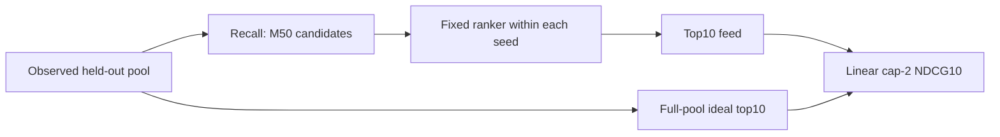
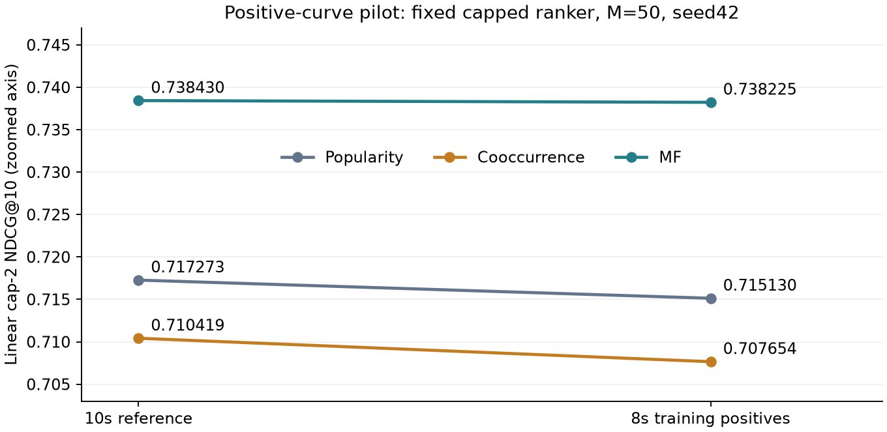

# Recall → rank: utility and integration contract

**Approved direction:** clear-negative BPR MF → **capped-target MAE Wide & Deep**.
**Final objective:** high watch ratio with bounded repeat-watch credit.
The earlier five-seed results use raw-target ranking; capped ranking currently has
seed42 evidence only. Reconfirm after the architecture and recall protocols freeze.

## Three distinct contracts

| Stage | Training target / loss | Checkpoint or evaluation |
|---|---|---|
| Recall | Duration-adjusted binary pairs; BPR against clear observed negatives | Select highest macro binary Recall50 within15 epochs |
| Rank | Event target `min(2, r)`; MAE, event weighting | Select highest full-pool cap-2 NDCG10 within120 epochs |
| Final feed | First-event gain `g = min(2, r)` | Macro cap-2 NDCG10 at M50; M20/100 sensitivities |

All ties retain the earliest checkpoint. Ranker: IDs + log duration, hidden128/32,
AdamW lr=.001, weight decay0, batch1024, no dropout. One selected checkpoint is
shared by all retrieval methods and budgets within a seed. Predictions are not clipped.

For user `u`, `DCG@10 = sum(gain_i / log2(i+1))` for ranks1–10.
Divide by the DCG of the highest-gain ten items in the **full eligible pool**,
including unretrieved items; average users equally. No exponential gain. Missing slots
have zero gain; zero-IDCG users are excluded and counted. Here all7,176 have positive IDCG.

## Why align the labels now?

**Decision:** use the same cap2 utility definition in ranking targets and final-feed
gains. We accept the seed42 MF/M50 decrease .740335→.738430 (−.001905) for the
clearer modeling contract. This is a deliberate objective choice, not a performance
win or evidence that all ratios above2 are noise. Capping bounds label values;
it does not delete those events. Keep raw ratios for audits.

Raw training was previously retained because it scored higher in the matched pilot.
That evidence remains valid, but performance alone does not determine the utility
definition. MAE and NDCG still differ: MAE estimates a conditional median and does
not directly optimize top-K utility. Event-weighted training and first-event,
equal-user evaluation also remain distinct.

Different training losses can be evaluated with the same NDCG
([TensorFlow ranking example](https://www.tensorflow.org/recommenders/examples/listwise_ranking)).
That does not make different training/evaluation labels a required best practice.

## Evidence to review

**Historical evidence:** the five-seed panel above uses raw-trained rankers;
it does not confirm the newly adopted capped-target recipe.

The PR description is the concise experiment note. Supporting data:
[five-seed funnel metrics](results/funnel_validation.csv),
[fixed-checkpoint target pilot](results/target_pilot.csv).

- Seeds42–46, with42 reused from exploration;43–46 rerun under frozen selection,
  but with prior project ranking history. Same split, comparable budgets and shared
  ranker within each paired retrieval comparison. Report sample SD, not standard error.
- Across seeds both MF and ranker change; their individual variance contributions
  are not identified. Repeated validation use remains a limitation.
- A higher binary Recall need not produce higher capped feed utility. Candidate
  oracle is a hindsight diagnostic; its gap is not entirely learnable.
- Duration concentration and observed-pool selection remain; this is not a temporal,
  causal, cold-start or online-lift result. No new test evaluation.

## Curve sensitivity

Only positive **training** labels changed10s→8s; original negative membership,
validation relevance, pools and capped seed42 ranker (epoch111) stayed fixed.
Popularity/cooccurrence were rebuilt; MF received15epochs in both arms.
[All budgets and oracle metrics](results/recall_curve_funnel.csv).

| Method | Cap2 NDCG10,10s | Cap2 NDCG10,8s | Difference at M50 |
|---|---:|---:|---:|
| Popularity | .717273 | .715130 | −.002143 |
| Cooccurrence | .710419 | .707654 | −.002765 |
| MF | .738430 | .738225 | −.000205 |

MF candidate-oracle NDCG also fell .986564→.986144; M20 improved by .000310,
but predeclared headlineM50 did not. No performance-based reason to replace10s.
MF's final feed still averages9.74 of10 videos at≤10s: this change does not resolve
duration concentration. Equal epochs mean9.36% more training pairs in the8s arm.
One exploratory seed cannot establish a reliable loss or prove10s is optimal.

## Integration checks and code

- Re-map raw IDs with the saved ranker vocabulary. Use training-only per-video
  median duration, never the held-out event's duration or outcomes as features.
- Verify data/source/checkpoint hashes, frozen ranker prediction parity, candidate
  identity, support masking, full-pool denominators and deterministic ties.
- The older `recall_rank` adapter reports **binary** metrics. Use `GainPool` and
  the `ranking_target` evaluator for the primary **graded cap-2** metric; do not
  interpret the older binary summary as capped-watch utility.
- `ranking_target` reproduces the controlled raw/capped pilot given prepared
  ranking/recall artifacts and the historical reference directory. It preserves
  complete epoch curves and rejects accidental overwrite. Its CLI defaults describe
  the recorded local experiment; data and model checkpoints are not bundled.

Read: `experiments/recall_rank.py` (feature adapter) →
`training/funnel_evaluation.py` (gain/denominators) →
`experiments/ranking_target.py` (selector and controlled training) → the synthetic tests.

## Review and merge order

Review milestones: ranking foundation → ranking EDA → ranking training →
**4. Wide & Deep architecture exploration** → **5. Recall** → **6. Integration**.
Drafts can be reviewed while their bases are open; merge foundations first, then
retarget/check each dependent PR after architecture work. Existing GitHub PR#4/#5
are recall/integration; review milestone numbers do not rename those PRs.
Next: channel merging, then YouTube DNN; ANN optional if scale warrants it.
DNN does not itself require a next-watch objective; that needs a valid temporal
protocol. Brief-watch encoders and snapshots remain separate feature ablations.
