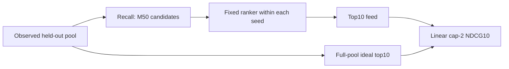
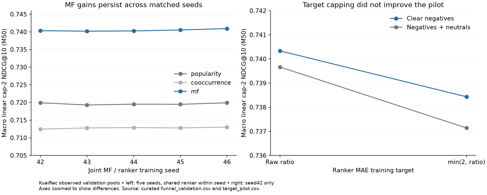

# Recall → rank: utility and integration contract

**Retained recipe:** clear-negative BPR MF → raw-target MAE Wide & Deep.
**Final objective:** high watch ratio with bounded repeat-watch credit.

## Three distinct contracts

| Stage | Training target / loss | Checkpoint or evaluation |
|---|---|---|
| Recall | Duration-adjusted binary pairs; BPR against clear observed negatives | Select highest macro binary Recall50 within15 epochs |
| Rank | Raw event watch ratio; MAE, event weighting | Select highest full-pool cap-2 NDCG10 within120 epochs |
| Final feed | First-event gain `g = min(2, r)` | Macro cap-2 NDCG10 at M50; M20/100 sensitivities |

All ties retain the earliest checkpoint. Ranker: IDs + log duration, hidden128/32,
AdamW lr=.001, weight decay0, batch1024, no dropout. One selected checkpoint is
shared by all retrieval methods and budgets within a seed. Predictions are not clipped.

For user `u`, `DCG@10 = sum(gain_i / log2(i+1))` for ranks1–10.
Divide by the DCG of the highest-gain ten items in the **full eligible pool**,
including unretrieved items; average users equally. No exponential gain. Missing slots
have zero gain; zero-IDCG users are excluded and counted. Here all7,176 have positive IDCG.

## Why train raw and evaluate capped?

**This is an empirical surrogate choice, not a claim that the objectives agree.**
In the matched seed42 pilot, capped labels improved capped MAE but reduced final
cap-2 NDCG. Both models were selected and evaluated by the same fixed utility.
Neither raw-MAE nor capped-MAE directly optimizes NDCG: MAE estimates a conditional
median, while top-K utility concerns ordering and selection.

Capping is monotone: it does not reverse observed preferences, but makes all ratios
above2 equally valuable. Raw training still distinguishes that tail. With MAE,
a target10 and target2 both yield gradient−1 when the prediction is1; tail ratio
sum is **not** gradient mass. Parameter sharing and finite optimization can still
change the learned ordering. The pilot does not establish why one recipe won.

Using a surrogate loss is standard ([TensorFlow ranking example](https://www.tensorflow.org/recommenders/examples/listwise_ranking));
that does not establish raw-versus-capped labels as a universal best practice.
The capped-target alternative was tested at one seed only; no general superiority claim.

## Evidence to review

The PR description is the concise experiment note. Supporting data:
[five-seed funnel metrics](results/funnel_validation.csv),
[fixed-checkpoint target pilot](results/target_pilot.csv).

- Seeds42–46, with42 reused from exploration;43–46 rerun under frozen selection,
  but with prior project ranking history. Same split, comparable budgets and shared
  ranker within each paired retrieval comparison. Report sample SD, not standard error.
- Across seeds both MF and ranker change; their individual variance contributions
  are not identified. Repeated validation use remains a limitation.
- A higher binary Recall need not produce higher capped feed utility. Candidate
  oracle is a hindsight diagnostic; its gap is not entirely learnable.
- Duration concentration and observed-pool selection remain; this is not a temporal,
  causal, cold-start or online-lift result. No new test evaluation.

## Integration checks and code

- Re-map raw IDs with the saved ranker vocabulary. Use training-only per-video
  median duration, never the held-out event's duration or outcomes as features.
- Verify data/source/checkpoint hashes, frozen ranker prediction parity, candidate
  identity, support masking, full-pool denominators and deterministic ties.
- The older `recall_rank` adapter reports **binary** metrics. Use `GainPool` and
  the `ranking_target` evaluator for the primary **graded cap-2** metric; do not
  interpret the older binary summary as capped-watch utility.
- `ranking_target` reproduces the controlled raw/capped pilot given prepared
  ranking/recall artifacts and the historical reference directory. It preserves
  complete epoch curves and rejects accidental overwrite. Its CLI defaults describe
  the recorded local experiment; data and model checkpoints are not bundled.

Read: `experiments/recall_rank.py` (feature adapter) →
`training/funnel_evaluation.py` (gain/denominators) →
`experiments/ranking_target.py` (selector and controlled training) → the synthetic tests.

## Review and merge order

Ranking foundation → ranking EDA → ranking training → **MR1 recall** → **MR2 integration**.
Drafts can be reviewed while their bases are open; merge foundations first, then
retarget/check each dependent PR. DNN, merging retrieval channels, ANN, snapshots,
new label sweeps and additional tasks remain outside these PRs.
